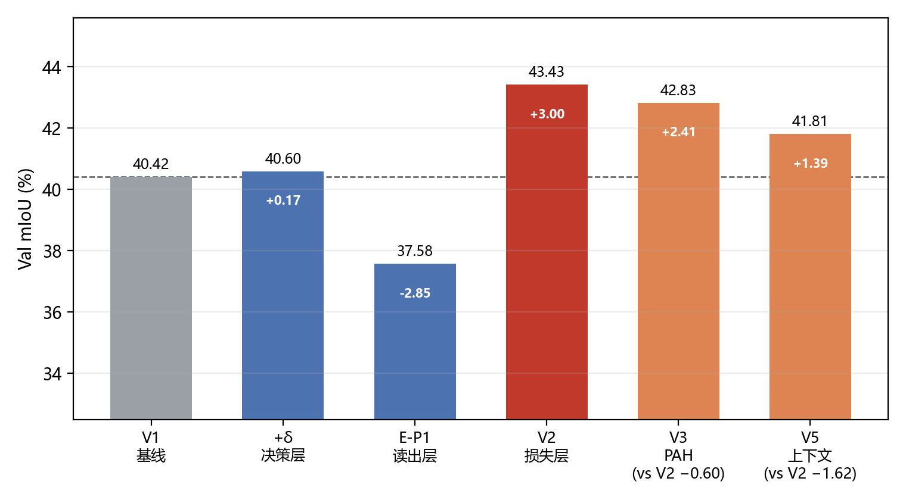
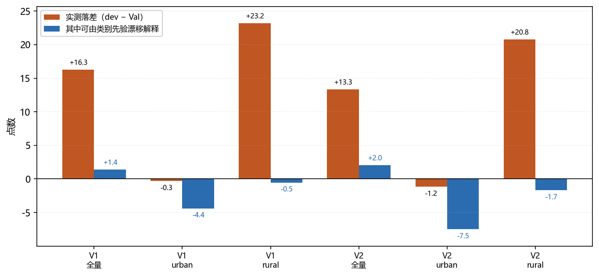

# 固定轻量预算下的遥感土地覆盖分割：类别不平衡与城乡域差的分层归因

**Layer-wise attribution of class imbalance and urban→rural degradation in lightweight land-cover segmentation (LoveDA, 3.48 M parameters).**

[](https://www.python.org/)
[](https://pytorch.org/)
[](LICENSE)

---

## 这个仓库在做什么

遥感土地覆盖分割在星上与边缘平台上的部署受严格算力约束。把模型压到 3~4 M 参数之后，
"类别不平衡"与"城乡域差"会同时出现，但**该往哪一层投入改进**缺少判据——是判决阈值没调好，
是分类头不够宽，还是特征本身没把少数类分开？

本仓库不复现某个 SOTA，而是把这个问题改写成一个可测的归因问题，并给出一条可复用的判定流程：

> 先分清"没看出来"还是"判错了"，再从最便宜的改法开始试，
> 每试一步都用**同一张考卷**（1024² 全图滑窗的官方验证集）重新量测这一层还能回收多少。

判定的结论是：**在这个预算下，决策层几乎没有余量，收益来自损失层的组合效应且只在跨域兑现，
而所谓"跨域落差"实际上是乡村子集的单侧失效。**

<p align="center">
  
  <br>
  <sub>六级干预阶梯：同一数据、同一评测协议下逐级改动能拿回多少（虚线为 V1 基线 40.42）</sub>
</p>

---

## 主要结果

全部数值来自 1024×1024 全图滑窗（窗口 512、步长 256、概率平均），官方 Val 集 1669 幅。
模型选择只用 dev（Training 集留出的 253 幅），Val 只在最后评测时读一次。

| 版本 | 改动位置 | 参数量 | GFLOPs @512² | Val mIoU | dev mIoU | 落差 |
|---|---|---|---|---|---|---|
| V1 | 自研轻量基线，朴素 CE | 3.484 M | 6.71 | 40.42 | 56.69 | 16.27 |
| **V2** | 损失层：逐图逆频率加权 + Dice + 边界加权 | 3.484 M | 6.71 | **43.43** | 56.75 | 13.32 |
| V3 | 结构·读出：瓶颈接先验感知头 PAH | 3.543 M | 6.71 | 42.83 | 56.07 | 13.24 |
| V5 | 结构·上下文：SE 门控换成 ASPP-Lite | 3.447 M | 6.73 | 41.81 | 57.22 | 15.41 |
| E10 UNet-R34 | 外部基线（ImageNet 预训练） | 24.568 M | 36.69 | 43.16 | 54.53 | 11.37 |
| E11 DeepLabV3+ | 外部基线（ImageNet 预训练） | 39.636 M | 163.57 | 50.75 | 65.83 | 15.08 |
| E12 SegFormer-B0 | 外部基线（从零训练） | 3.454 M | 2.72 | 39.75 | 53.84 | 14.09 |

三个结构版本（V1 / V3 / V5）参数量相差不到 2.8%，因此它们的指标差可直接归因于结构改动。

### 四条结论

**1. 决策层几乎没有可回收余量。**
在 dev 上拟合逐类 logit 偏置（E-δ），dev 自身 +0.30，迁移到 Val 只剩 **+0.17**；
只用先验形式的 τ 扫描，最优解是 **τ\* = 0**（完全不校正）；
即便"直接看答案"在 Val 上拟合的乐观上界也只有 **+1.67**，约占总落差 16.27 的 10%。

**2. 少数类的信息在特征里，但判别可分性不足。**
冻结全部特征与归一化统计量、只以完全逆频率重训 520 参数的分类头（E-P1），Val 反而 **−2.84**；
把读出容量扩到 72 倍后进一步降到 **−3.23**。裸地 IoU 可以 +9.94，
代价是背景 −13.19、建筑 −10.93——这是两类在特征空间中高度重叠的表现，不是读出容量的问题。

**3. V2 的 +3.00 来自三项损失的耦合，不属于任何单项。**
三项单因素增益为 −0.53 / +1.30 / −1.05，之和 **−0.28**，而三项全开 **+3.00**，
交互项 **+3.29**。且这份收益几乎全在跨域：dev 只 +0.06，Val +3.00。
起点不同是原因——dev 上裸地召回已 54.4（过度预测），Val 上只有 20.3（欠预测），
同一组权重推一把，一处白推、一处有效。

**4. "跨域落差"实为乡村子集的单侧失效。**
七个模型的城区子集在 dev→Val 之间几乎不动（−3.8 ~ +2.5），乡村子集一致下降 20.3 ~ 23.4；
先验漂移的贡献为 −2% ~ −8%（负贡献，因为 mIoU 是宏平均）。
进一步的专项核查显示，乡村农田 **38.2%** 的像素被判成背景或水体，其中 **93.5%** 落在
腐蚀后的农田核心区（不是田埂水渠）、**83.8%** 在光谱上已具备水体或低暗特征
（判对组仅 34.0%）——这是**土地利用标注与地表覆盖特征的口径错位**，
不属于提高分辨率、加强边界约束或统计归一化能回收的余量。

<p align="center">
  
  <br>
  <sub>落差分解：城区几乎不变，乡村一致下降；先验漂移的贡献为负</sub>
</p>

### 与外部基线的比较（一条容易被误读的结论）

3.484 M、从零训练的 V2 取得 43.43，与 24.568 M、带 ImageNet 预训练的 UNet-R34（43.16）
**持平**，参数少 7.1 倍。但两者的差 0.27 落在单种子噪声带（0.65）之内，
因此本仓库**不主张**"架构更优"：预训练的贡献无法从现有设计里分离。
本仓库同样**不主张**优于 DeepLabV3+——后者 50.75，代价是 24.4 倍算力，属于另一个预算档。

---

## 目录结构

```
.
├── code/
│   ├── paths.py                 所有路径的唯一出口（以仓库根为基准，可用 RS_ROOT 覆盖）
│   ├── imgio.py                 中文路径安全的图像读写（np.fromfile + cv2.imdecode）
│   ├── models/                  v1.py（自研基线）v3.py（PAH）v5.py（ASPP-Lite）baselines.py
│   ├── configs/                 11 份 YAML，所有 run 的超参快照
│   ├── loveda_dataset.py        数据集与划分索引
│   ├── losses.py  metrics.py    三项损失、混淆矩阵指标
│   ├── train.py                 统一训练入口（模型无关，读 config）
│   ├── evaluate.py  eval_split.py  eval_pah.py    全图滑窗评测（Val / dev / V3 四模式）
│   ├── fit_threshold.py         E-δ：逐类偏置校正 + Val 上界
│   ├── probe.py                 E-P1：冻结特征重训读出（含容量控制）
│   ├── gap_decompose.py         落差分解：城区 / 乡村 / 先验漂移解释量
│   ├── v5_mechanism.py          V5 的预测份额与块状化中介检验
│   ├── step0_*.py               乡村农田流向专项核查（形态 + 光谱）
│   ├── dataset_statistics.py    类别频率、目标尺度、类间邻接
│   ├── make_figure_*.py         论文插图
│   └── collect_results.py  ablation_table.py  bench_all.py    汇总 / 消融表 / 效率基准
├── data/
│   ├── splits.json              固定划分：train 2269 / dev 253（seed 42）
│   ├── stats/                   统计缓存（类别频率、几何、邻接、逐图份额）
│   └── raw/LoveDA/              数据集，需自行下载（不随仓库分发）
├── experiments/
│   └── <run>/                   config.yaml、eval_*.json、cm_*.json、train_log.csv
├── results/
│   ├── figures/                 16 张插图
│   └── tables/                  results_summary、消融、效率、参数量扫描
├── code/requirements.txt
├── LICENSE
├── .gitignore
└── README.md
```

**仓库不包含**：数据集（CC BY-NC-SA 4.0）、模型权重（`*.pth`）、概率缓存（`*.npz`）、
训练日志与逐图预测缓存。这些可由下面的命令重新生成。

---

## 环境

```bash
conda create -n rs python=3.10 -y
conda activate rs
pip install torch==2.5.1+cu121 torchvision==0.20.1+cu121 \
    -f https://mirrors.aliyun.com/pytorch-wheels/cu121/
pip install -r code/requirements.txt
```

实测环境：Python 3.10.22 / torch 2.5.1+cu121 / torchvision 0.20.1+cu121 / RTX 3060 Laptop 6 GB。

> Windows 下若 pip 报 `PermissionError: accesstest_deleteme...`，
> 在前面加 `PYTHONPATH= PYTHONNOUSERSITE=1` 绕过外部 sitecustomize 钩子。

---

## 数据准备

数据集不随源码分发，需从官方获取（CC BY-NC-SA 4.0，仅限学术用途）：
<https://rsidea.whu.edu.cn/LoveDA.htm>（Zenodo 或百度网盘，提取码 27vc）。

期望的目录结构（全部下载后可跳过下载脚本）：

```
data/raw/LoveDA/
├── Train/{Urban,Rural}/{images_png,masks_png}/*.png     # 1156 + 1366
└── Val/{Urban,Rural}/{images_png,masks_png}/*.png       # 677 + 992
```

若从镜像拉取：

```bash
python code/fetch_tree.py --subsets Train/Urban Train/Rural
python code/fetch_tree.py --subsets Val/Urban Val/Rural
```

**标签编码（务必确认）**：`0 = no-data（忽略）`、`1 = background`、`2 = building`、
`3 = road`、`4 = water`、`5 = barren`、`6 = forest`、`7 = agriculture`。
网上部分资料写成"7 = background"，照此实现会让指标静默错位。

---

## 复现

全部命令在仓库根目录执行。每个 run 在 6 GB 显存上约 37~40 分钟（30 epoch）。

```bash
# ---------- 0) 一次性准备 ----------
python code/make_splits.py                    # train 2269 / dev 253（seed 42）
python code/dataset_statistics.py             # 类别频率 / 尺度 / 邻接 -> data/stats
python code/train_class_weights.py            # 全局类频率（消融用）
python code/calibrate_share.py                # 逐图份额对齐系数 k_c（V2 使用）
python code/make_figures.py                   # 数据集类插图

# ---------- 1) V1 基线 ----------
python code/train.py    --config code/configs/e0_ce.yaml --model v1 --run V1_ce --epochs 30
python code/evaluate.py --config code/configs/e0_ce.yaml --model v1 --run V1_ce --split val
python code/eval_split.py --run V1_ce --split dev

# ---------- 2) 判 H2 / H3：决策层与读出层 ----------
python code/fit_threshold.py --run V1_ce --model v1 --config code/configs/e0_ce.yaml --cache-val
python code/probe.py --run V1_ce --mode balanced --head last --epochs 8

# ---------- 3) V2：损失层 ----------
python code/train.py    --config code/configs/v2.yaml --model v1 --run V2 --epochs 30
python code/evaluate.py --config code/configs/v2.yaml --model v1 --run V2 --split val

# ---------- 4) V3：先验感知头（一次推理给出四种先验）----------
python code/train.py    --config code/configs/v3.yaml --model v3 --run V3 --epochs 30
python code/eval_pah.py --run V3 --model v3 --config code/configs/v3.yaml

# ---------- 5) V5：上下文替换 ----------
python code/train.py    --config code/configs/v5.yaml --model v5 --run V5 --epochs 30
python code/evaluate.py --config code/configs/v5.yaml --model v5 --run V5 --split val
python code/v5_mechanism.py --run V5

# ---------- 6) 三条外部基线 ----------
python code/train.py --config code/configs/e10_unet.yaml      --model unet_r34      --run E10_unet
python code/train.py --config code/configs/e12_segformer.yaml --model segformer_b0  --run E12_segformer
python code/train.py --config code/configs/e11_deeplab.yaml   --model deeplabv3p_r50 --run E11_deeplab

# ---------- 7) 归因分析 ----------
python code/gap_decompose.py --from-cache --splits dev val
python code/step0_agri_flow.py                # 乡村农田流向：形态 + 光谱核查

# ---------- 8) 汇总、制表、出图 ----------
python code/collect_results.py                # -> results/tables/results_summary.md
python code/ablation_table.py                 # -> 消融表 + 图
python code/bench_all.py                      # -> results/tables/efficiency.json
```

路径解析统一走 `code/paths.py`，默认以仓库根为准。数据放在别处时用环境变量覆盖：

```bash
RS_ROOT=/data/rs_course python code/train.py --config code/configs/v2.yaml --model v1 --run V2
```

训练中断后用 `--resume` 从 `last.pth` 续训（日志追加，不覆盖已有 epoch）。

---

## 评测协议

| 项 | 设置 | 理由 |
|---|---|---|
| 训练输入 | 512 随机裁剪，随机缩放 0.75–1.5 | 6 GB 显存下的最大可行尺寸 |
| 模型选择 | dev（Train 留出 10%，253 幅，seed 42） | Val 只读一次，避免"照着考卷改方法" |
| 报告口径 | 1024² 全图滑窗，窗口 512 / 步长 256，概率平均 | 与训练期 512 center-crop 监控值相差可达 1 点以上，不可混用 |
| 主指标 | 7 类平均 IoU（宏平均，与类别像素数无关） | 长尾下 OA 会被背景吞掉，不能作主指标 |
| 噪声带 | \|Δ\| < 0.65 不作解读 | 由同一 run 内不同检查点的差值实测标定 |

dev 与训练集同源：99.6% 的 dev 影像在训练集中存在空间邻居，因此 dev 指标应理解为
**同分布上界**而非泛化估计。本仓库只用它做域间对照，不用其绝对值论证任何结论。

---

## 代码里几个值得一读的地方

- **`code/models/v1.py`** —— 设计原则是"参数按算力成本反向分配"：卷积参数量 ∝ C_in·C_out·k²，
  算力 ∝ H·W·C_in·C_out·k²，两者只差 H·W。因此 stage4（1/32 分辨率）拿走近一半参数
  却只消耗 6.6% 算力，浅层则相反。`widths` 参数可直接改宽度做缩放实验。
- **`code/paths.py`** —— 所有路径的唯一出口。换数据位置只改这一处，或设 `RS_ROOT`。
- **`code/losses.py`** —— 三项损失。逐图逆频率权重带 `clip(·, 0.5, 4.0)` 与份额对齐系数 k_c，
  不加这两个约束时少数类会被逐图归一化饿死（裸地曾掉到全局份额的 0.60 倍）。
- **`code/models/v3.py`** —— PAH 用全局平均池化而非空间注意力：要估的是"这幅图的类别构成"
  这组标量，与像素位置无关。

---

## 已知限制

1. **单种子**。所有结论建立在一次训练之上，故 |Δ| < 0.65 一律不作解读。
2. **dev 存在空间泄漏**（99.6% 有训练集邻居），只能当同分布上界用。
3. **基线初始化不对称**：E10/E11 用 ImageNet 预训练，E12 与自研版本从零。
   该差异对基线有利，故本文对比是保守的；但也意味着"参数少 7.1 倍而精度持平"
   不能读成架构优势。
4. **消融未做 2³ 全因子**，只给三项之和、组合值与总交互项，不排序单项贡献。
5. **乡村失效中含约八成的标注口径成分**，因此乡村子集的 mIoU 存在一个由标注决定的天花板，
   35.36 / 36.14 应在此前提下理解。

---

## 许可

代码 MIT（见 `LICENSE`）。数据集 LoveDA 为 CC BY-NC-SA 4.0，不随本仓库分发，
商用前请自行确认许可条款。

## 致谢

LoveDA 数据集由武汉大学 RSIDEA 团队发布。本工作源于一次课程项目，
训练在单张 RTX 3060 Laptop（6 GB）上完成。
