# 固定轻量预算下的遥感土地覆盖分割：类别不平衡与城乡域差的分层归因

**技术报告 · v1.0 · 2026 年 11 月**

> 本文件是本仓库配套技术报告的在线阅读版。同一内容的 Word 版见
> [`loveda-attribution-report.docx`](loveda-attribution-report.docx)（含 LaTeX 公式排版）。
> 代码、配置、实验产物与数据集说明见 [README](../README.md)。

---

## 摘要

遥感土地覆盖分割在星上与边缘平台的部署受严格算力约束，而LoveDA数据集同时叠加了类别长尾（6.7:1）与城乡域差两重困难，使“该往哪里投入改进”缺乏判据。本文不再以提升榜单指标为目标，而是把问题改写为可测的归因问题：在给定预算下，误差产生在决策层、读出层还是表征层？为此建立两层归因框架，指出训练时的类别加权与推理时的先验校正作用在同一类别先验上但干预位置不同，因而并不等价；据此设计一条从“动决策”到“动结构”的干预阶梯，每一级都以全图滑窗的官方验证集重新量测可回收的余量。

实验以一个自研的轻量编解码网络为基线（3.484 M参数、6.71 GFLOPs，验证集mIoU 40.42），其设计原则是“参数集中于低分辨率段、算力分散于浅层”，使近半数参数只消耗6.6%的算力。三项结果沿同一条证据链递进：决策层阈值校正在同分布上仅+0.30、跨域仅+0.17，即便在验证集上直接拟合（乐观上界）也只有+1.67，故决策层几乎无余量；冻结特征后以逆频率重训读出使mIoU下降2.84，读出容量扩大72倍后降至3.23，说明少数类信息在特征中但判别可分性不足；损失层三项组合带来+3.00，而单项之和为−0.28，交互项+3.29，说明收益主体来自三项的耦合而非任何单项。

进一步定位跨域落差的来源：七个模型的城区子集在域间几乎不变（−3.8~+2.5），乡村子集一致下降20.3~23.4，先验漂移仅能解释−2%~−8%；专项核查显示其中约八成像素在光谱上已具备水体或低亮度特征、与土地利用标注系统性错位，故不属可回收的余量。与外部基线相比，3.484 M从零训练与24.568 M加ImageNet预训练的UNet-R34持平（43.43对43.16），参数少7.1倍。

结论是：在固定轻量预算下，决策层没有可回收余量，收益来自损失层的组合效应且只在跨域兑现，而跨域问题的实质是乡村子集的单侧失效。

关键词：语义分割；类别不平衡；长尾学习；域偏移；轻量模型；归因分析

## 1 引言

土地覆盖分割的部署条件正在从地面机房向星上与边缘平台迁移，这一变化重塑了模型设计的约束：可用的参数与算力不再是“越多越好”，而是被功耗与带宽钉死在一个量级上。本章先说明这一约束的来源，再把数据的三重困难转述为一个可测量、可否证的问题。

### 1.1 研究背景与问题提出

土地覆盖制图是遥感影像最主要的应用形式之一，其产物直接服务于城市扩张监测、耕地保护核查、生态环境评估与灾害应急。随着高分辨率传感器（0.3~1 m量级）的普及，单幅影像的像素规模达到10⁶ 量级，逐像素分类必须依赖深度语义分割网络完成。

卫星与无人机受功耗、内存与下行带宽三重约束，可承载的模型规模远小于地面服务器，这正是上述约束的具体来源。文献[1] 面向星上云检测明确指出，标准U-Net常超过30 M参数，其功耗与内存需求已超出小卫星与无人机平台的承受范围，并给出以深度可分离卷积、去除跳连、激进缩减通道为手段的紧凑架构，在云检测任务上以约五百分之一的规模取得与U-Net持平的精度。这一结果提示：遥感分割中相当一部分精度并不依赖参数规模，模型规模的选择应当由部署预算决定，而不是由榜单决定。

在此背景下，本文选择LoveDA作为研究对象[2]。该数据集包含4191幅0.3 m分辨率的1024×1024影像，标注为7个真实类别（背景、建筑、道路、水体、裸地、林地、农田，官方类标1–7，0为无效区）。它同时具备三重困难。

第一，类别分布极度长尾。训练集中出现频率最高的类与最低的类相差6.7倍，且裸地在部分子区域中接近缺失。

第二，存在显式的城乡域差。数据集按城区（urban）与乡村（rural）两个域名组织，两域的目标构成差异巨大，例如农田在城区子集中仅占1.8%，在乡村子集中占34.4%。更关键的是，官方划分中训练集与验证集的域构成并不匹配，使“在训练分布上表现良好”不能保证“在验证分布上表现良好”。

第三，目标尺度跨度大。农田等类别常形成上万个像素的均质大块，而道路、建筑则表现为窄条与密集小目标，同一网络必须同时处理三个量级以上的空间尺度。

这三重困难只是初步印象。第3章将对数据集做四个维度的定量分析（类别分布、目标尺度与空间结构、城乡构成、误差的空间分布），并据此把问题界定为五个可判定的假设——其中一条会在分析阶段就被排除。

### 1.2 现有工作的缺口

针对上述困难，已有大量工作从损失函数、网络结构、域适应三个方向提出改进，典型代表包括U-Net[3] 的编解码结构、DeepLabV3+[4] 的空洞可分离卷积与多尺度上下文、SegFormer[5] 的轻量Transformer编码器等。这些工作报告的典型形式是“替换了某个组件，指标提升若干点”。

这种报告方式留下一个未被回答的问题：提升究竟来自哪一层？分类网络的推理可以分解为“特征提取”与“基于特征的决策”两个阶段，前者决定后验概率的形状，后者决定在给定后验下如何划分判决区域。同样一个百分点，可能来自特征变得更可分，也可能只是判决边界被挪到了更合适的位置——两者的后续投入方向完全相反：前者要继续改结构或损失，后者只需在推理端加一个偏置。

对类别不平衡任务而言，这个区分尤其重要。重加权、重采样、logit校正、阈值移动在文献中常被并列讨论，但它们在上述两层中的位置并不相同。若不先判定“损害在哪一层”，改进就只能靠试错，而每一次试错的成本在遥感全图滑窗评测下并不低。

### 1.3 本文的思路与贡献

本文的做法是先把问题改写成可测形式，再据此选定干预位置，每次干预后重新量测。承载这条思路的是三个自研模型：3.484 M的轻量编解码基线V1，以及各做一处结构替换的两个变体V3（先验感知头）与V5（多尺度上下文）；三者参数量为3.484 / 3.543 / 3.447 M，预算基本对等，故增益可直接比较。在此之上，本文建立两层归因框架与一条由弱到强的干预阶梯——先动决策、再动读出、再动损失、最后动结构，每一级都以同一套协议重新评测，把“还能回收多少”变成可以逐级读取的量。

本文的贡献有四条。

其一，提出两层归因框架并给出可推导的结论：加权交叉熵的最优解满足，取对数即对logit逐类加常数。故“训练时缺先验建模”与“推理时阈值偏移”是同一件事的两面，但干预位置不同——前者经梯度改表征，后者不改任何权重，因而不等价。

其二，用三条独立路线一致否证“决策层尚有可观余量”：逐类阈值校正、冻结特征后的均衡读出、带逐图先验估计的校正头，诚实收益分别为+0.17、−2.84、−0.60，且第三条在给定真值先验时仍为负。

其三，把“跨域落差”定位为具体事实：落差几乎全部来自乡村子集，与模型容量、类别构成变化均无关。这比“存在域偏移”更强，因为它可被否证，也直接指向后续工作对象。

其四，以单因素消融表明主模型收益不属于任何单项：三项损失的单项效应为−0.53、+1.30、−1.05，之和−0.28，组合却达+3.00，交互项+3.29。

## 2 相关工作

本章按干预位置组织已有研究：先看网络结构与规模预算，再看损失层的不平衡处理，再看决策层的校正，最后看域偏移。如此安排不为罗列，而是标定本文的切入点位于何处。

### 2.1 语义分割网络与轻量化预算

编解码是语义分割的基本范式。U-Net[3] 以对称的下采样—上采样与跳连融合浅层细节，至今仍是遥感分割最常用的基线；DeepLabV3+[4] 以空洞可分离卷积构造多尺度上下文，精度居前但计算量高；SegFormer[5] 用分层Transformer配轻量MLP解码器，其MiT-B0（3.7 M参数、8.4 GFLOPs @512²）在ADE20K上取得37.4 mIoU，是“轻量档”最常被引用的参照。

轻量化的另一条主线来自移动端骨干。MobileNets[6] 以深度可分离卷积把标准卷积拆为逐通道与逐点两步，同时压缩参数与计算；MobileNetV2[7] 以倒残差与线性瓶颈改善折中，3.4 M参数、约300 M乘加成为移动端视觉的事实标准；MobileNetV3[8] 引入架构搜索与h-swish，并以LR-ASPP为分割头，在3.2 M / 2.0 GFLOPs的预算下取得ADE20K 33.1 mIoU。实时方向，BiSeNetV2[9] 以细节与语义双分支在3.4 M / 21.2 GFLOPs（512×1024）下取得Cityscapes 72.6 mIoU，PP-LiteSeg[10] 以轻量解码器在3.6 M下取得73.0 mIoU。这些工作共同表明，3~4 M参数是实时与边缘分割中被反复验证的工程档位，而非某个模型的偶然取值。

残差学习[11] 解决了深层网络的退化问题，本文对比基线的编码器即源于此；EfficientNet[12] 则指出缩放应在固定资源约束下以复合系数平衡深度、宽度与分辨率，这是本文“先定预算、再定结构”的直接依据。

### 2.2 类别不平衡的损失层方法

损失层是最常被采用的干预位置。Focal Loss[13] 以调制因子降低易分样本权重；类平衡损失[14] 从“有效样本数”给出重加权系数的理论形式，指出简单逆频率加权在极度长尾下会过冲；Dice损失[15] 直接优化重叠度，与交叉熵组合时通常同时改善召回与区域一致性。

这些方法的共同前提是：不平衡的损害可以通过改变梯度权重来补偿。本文不否认这一点，但指出它只回答“用什么梯度”，没有回答“梯度该把表征推向何处”——后者是本文要用消融分离的量。

### 2.3 决策层校正与长尾学习

从贝叶斯决策看[16]，后验正比于似然与先验之积；当训练与测试的先验不同，最优判决边界随之平移，而这一平移可在推理端以logit加常数精确实现。Menon等[17] 将其形式化为logit adjustment，并证明在均衡误差意义下它对应一个一致的估计量；校准研究[18] 则指出深度网络的置信度普遍偏高，温度缩放可改善校准而不改变排序。

决策层校正的吸引力在于零训练成本，但其有效有一个隐含条件：后验的形状本身正确，只是判决点放错。若形状已被系统性扭曲，任何逐类常数都无法修复。6.2节对这一条件做直接检验。

### 2.4 域偏移、自适应与本文的区别

迁移学习综述[19] 把域偏移分为协变量偏移、先验偏移与概念偏移，三者的补偿手段不同。分割的域泛化多针对协变量偏移，如RobustNet[20] 以实例选择性白化去除风格敏感成分；批归一化[21] 的统计量在域间会发生漂移，故在测试域上重估BN统计量是零参数的最简自适应手段。

6.6节对LoveDA的跨域落差做了分解，结论是：在mIoU这一宏平均指标下，先验偏移的贡献为负，落差更接近概念偏移（同一类别在目标域的条件分布变得更难分），而非协变量偏移或先验偏移。

上述工作分别落在干预阶梯的不同位置。本文不在这些位置上各做一处增量改进，而是自研一个轻量基线、在其上做两次结构变体，再把三者连同损失层与决策层的手段放进同一量测框架，回答“在固定轻量预算下，哪一层的余量最大”。因此本文的产出主要是一组否证性结论与一条可复用的判定流程，而非一个新的最优指标。

## 3 数据集与分析

本章先交代数据集概况与划分、评测协议，再沿四个维度对它做完整的定量分析，最后据分析结果界定研究问题。四个维度是类别分布、目标尺度与空间结构、城乡构成、误差的空间分布；每一维度都给出可核查的数字，因为“数据不平衡”这一说法本身不足以支撑任何设计决策——必须知道不平衡长什么样、分布在哪里、是否与本文关心的误差有关。

### 3.1 数据集概况与划分协议

LoveDA[2] 面向域自适应语义分割构建，全部影像取自中国多个城市的Google Earth，空间分辨率0.3 m，单幅尺寸1024×1024，共4191幅。标注体系为7个真实类别：背景（background）、建筑（building）、道路（road）、水体（water）、裸地（barren）、林地（forest）、农田（agriculture），官方类标为1–7，类标0表示无效区（no-data），在训练与评测中均被忽略。数据集按城区与乡村两个域名组织，官方划分为训练集2522幅、验证集1669幅。

图3-1给出两个域的典型样例与真值（左两列为城区、右两列为乡村，每列上排为影像、下排为对应标注），直观可见三点差异。其一，目标形态不同：城区以密集、小尺度、边界规整的建筑与道路为主，乡村则是成片的农田、林地与水体。其二，构成不同：城区背景占比明显更高（大片硬化地表被判为背景），乡村以农田为主体。其三，同类地物的外观相去甚远，例如裸地在城区多为工地裸土，在乡村多为收割后的耕地，纹理与上下文均不同。

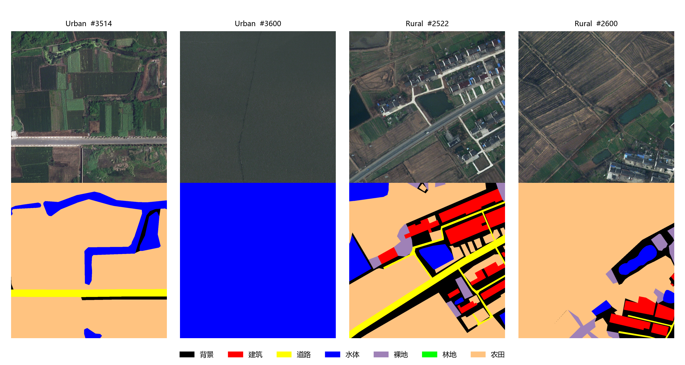

选择该数据集有三点理由：它是少数同时具备高分辨率、多类别与显式域标签的公开遥感基准；其类别分布与域构成恰好对应本文关心的两个问题；官方验证集规模（1669幅）足以分辨0.65点量级的差异（见5.2节）。

在此基础上，本文对数据划分作一处调整。若直接以官方验证集选点，该集合将同时承担“模型选择”与“性能报告”两项职责，报告值会因选择偏差而偏高。为此本文从官方训练集2522幅中按城乡域名分层随机抽取10%（253幅）构成开发集（dev），其余2269幅用于训练；官方验证集1669幅在训练期间完全不读取，仅在最终评测时运行一次。划分以固定随机种子生成，三部分无重叠。

需说明的是，dev与训练集同源：99.6%的dev影像在训练集中存在空间邻居，故dev指标应理解为“同分布上界”而非泛化估计。这一偏差对本文论证是保守的——它放大了dev与验证集的落差，而本文正是要解释落差的来源。

评测采用全图滑窗：512×512窗口、步长256滑动推理，重叠区按softmax概率平均，再对7个真实类重新归一化后取最大值（此举避免任何方法通过把像素推入no-data通道虚增指标）。主指标为mIoU，辅助报告OA、mF1、分域mIoU与逐类精确率、召回率。

表3-1汇总上述设定。

**表3-1　数据划分与评测协议**

| 项目 | 设定 |
|---|---|
| 数据集 | LoveDA，4191幅，1024×1024，0.3 m，7类（类标1–7，0为no-data） |
| 官方划分 | 训练2522 / 验证1669 |
| 本文划分 | 训练2269 / 开发253（训练集分层10%，seed 42）/ 验证1669 |
| 验证集使用 | 训练期不读取，仅最终评测一次 |
| 训练输入 | 512×512随机裁剪，随机缩放0.75–1.5 |
| 评测输入 | 1024×1024全图滑窗，窗口512，步长256，概率平均 |
| 输出处理 | 7类重新归一化后取argmax，不含no-data通道 |
| 主指标 | mIoU；辅以OA、mF1、分域mIoU、逐类P/R |
| 可解读下限 | 验证集0.65点、dev 1.5点以下不作解读（5.2节实测） |

### 3.2 数据集分析

本节按四个维度展开：类别分布（3.2.1）、目标尺度与空间结构（3.2.2）、城乡构成（3.2.3）、误差的空间分布（3.2.4）。前三者描述数据“难在哪”，后者回答“难在哪里的表现是什么”。

#### 3.2.1 类别分布：长尾，但“稀有不等于小”

训练集的类频分布如图3-2(a，纵轴对数)：出现最多的背景占35.6%，随后是农田20.3%、林地16.1%、建筑11.0%、水体6.4%、裸地5.4%、道路5.3%，最多与最少相差6.7倍。这一比值在单幅影像内会显著放大：部分乡村影像中裸地的像素占比不足0.5%，而在另一些影像中超过20%。因此“6.7:1”只能描述全集尺度，不能描述模型在单次前向中面对的分布。

图3-2(b) 把类频与平均目标尺度放在同一平面上（双对数轴），得到一个不那么直觉的结论：频率与尺度并不同向。裸地的像素占比只有5.4%，但其平均连通域面积超过10⁴ 像素，与农田同属“成片”类；建筑与道路的占比并不最低（11.0%与5.3%），目标尺度却最小（约10³ 像素量级）；背景占比最高，平均尺度却居中。

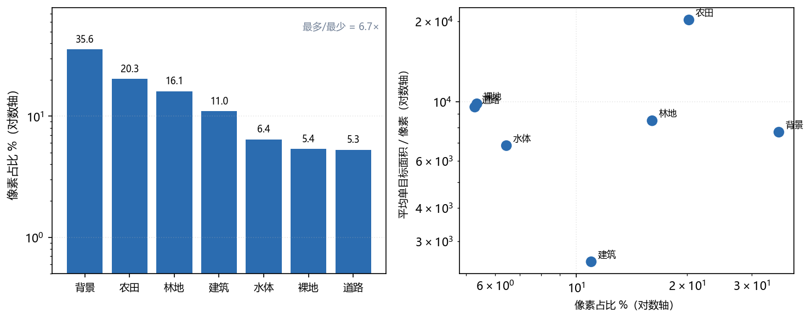

频率与尺度的这层错位有直接的实际含义：稀有性与小尺度是两个正交的困难，不能用同一个手段解决。 重加权、重采样针对的是稀有性（让梯度多分配给少样本类），提高分辨率或增大感受野针对的是尺度（让小目标获得足够多的像素与上下文）。若把两者混为一谈，就会得出“给裸地加权就能改善小目标”这类不成立的推论——而裸地恰恰是大块的，它的问题不是看不清，而是判不对。

#### 3.2.2 目标尺度与空间结构

图3-3给出各类在单幅影像内连通域面积的分布（对数轴）。农田的中位面积约8×10³ 像素，林地、水体、裸地、道路分布在10³ 量级，建筑最小（约8×10²）。背景的分布最特殊：四分位区间从个位数像素延伸到10⁵ 像素，跨度近五个量级。这说明背景在统计上不是一个类，而是一个异质集合——它同时包含大片的裸露地表、零散的边角与地物之间的缝隙。任何把背景当作单一语义类来建模的做法，都会在这个集合内部失效。

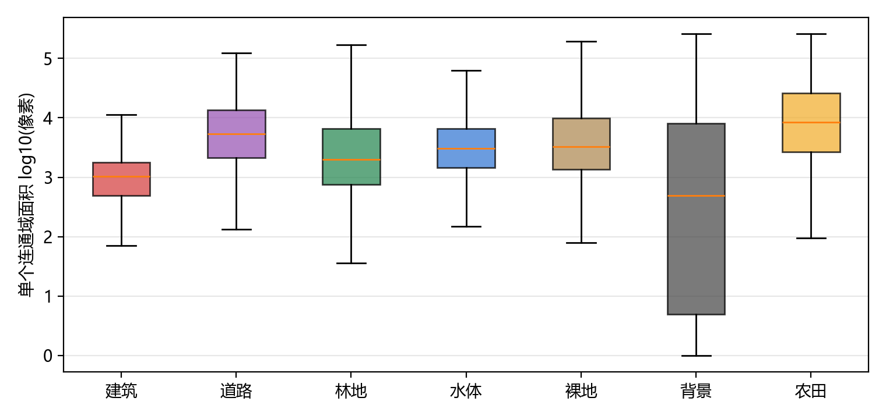

图3-4给出类间邻接强度（共边像素占全部邻接的百分比，对角灰格为类内、不计入），结果高度集中：前四强全部含背景（建筑15.6%、道路8.5%、林地6.9%、农田5.8%），而林地、农田、水体三者之间均不超过1.1%，几乎不直接共边。

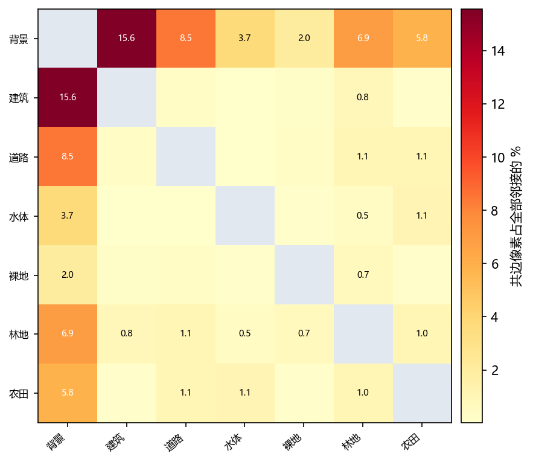

这说明在空间上，“背景—具体类”是唯一高频的界面，类与类之间很少直接相邻。由此可以预判：如果误差是沿着空间界面发生的，那么它首先表现为“具体类被吞进背景”或“背景被判成某个具体类”。6.1节的混淆矩阵证实了这一预判——V1有50.2%的误差像素被判为背景。

但需要立刻加一条限定：邻接矩阵回答的是“谁常共边”，不是“误差离边界多远”。共边可以发生在窄边界带上，也可以发生在同质区内部的孔洞与嵌块上。两者在改进手段上截然不同，故3.2.4节单独测量误差到边界的距离分布。

#### 3.2.3 城乡构成与域间先验差异

图3-5按四个子集（训练—城区、训练—乡村、验证—城区、验证—乡村）给出类别像素占比。差异是数量级的：训练—城区的背景占46.1%、农田仅7.5%、道路20.2%；训练—乡村的农田占34.4%、林地22.2%、背景降至24.6%。也就是说，模型在训练中见到的“农田”几乎全部来自乡村场景。

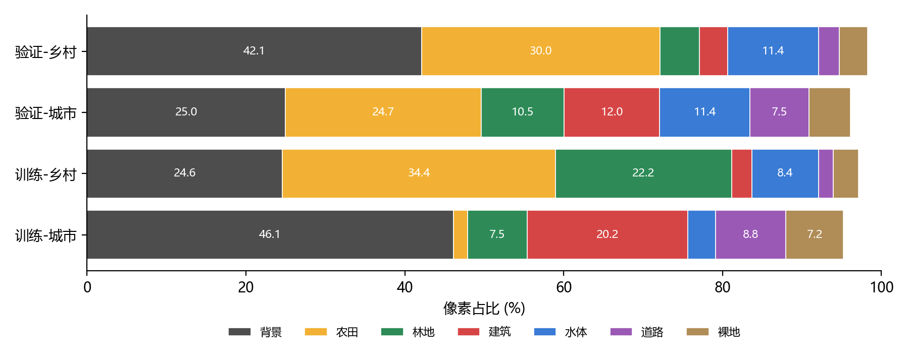

更值得注意的是同一域名的训练与验证构成也不一致：训练—城区背景46.1%，验证—城区只有25.0%；验证—乡村的背景42.1%，比训练—乡村高17.5个百分点。按L1距离度量，城区两域的构成差为0.746，乡村为0.448。

据此，先验差异在本数据上有三个层次：域之间（城区对乡村）、域内的划分之间（训练对验证）、单幅影像之间（同一域名的不同tiles构成差异极大）。这三层都会在推理时表现为“边缘分布与训练不符”。6.6节会证明：在mIoU这一宏平均指标下，这类先验差异对跨域落差的贡献为负，即它不是性能下降的原因。这一结论若不先在此处把先验差异量化清楚，是无从检验的。

#### 3.2.4 误差的空间分布：边界不是主战场

最后一个维度是误差本身的空间位置。本文在验证集上以真值为基准提取3像素宽的类别边界带，统计其像素占比与误差占比：边界带仅占全部像素的 2.7%，却只承载 4.0% 的误差。也就是说，超过96%的错误像素位于类别区域内部。

进一步测量误差像素到最近类别边界的距离：中位数为26.0像素，68.5%的误差像素距边界超过10像素；按所属同类连通域面积统计，99.9%的误差像素位于面积大于500像素的同质块内部（中位面积34万像素）。三条统计互相印证：误差不是在边界上“糊掉”的，而是在大块区域的内部被系统性地判错。

上述三条测量直接否定了H1（少数类误差主要来自边界），使本文无需为边界设计专门实验，也解释了后文为何把改进方向定在“区域级判别力”而非“边界精度”。同时它与3.2.2的邻接观察并不矛盾：背景与各类高频共边，但错误发生在这些界面内侧的整片区域，而不是界面本身的窄带。

### 3.3 问题的界定

上述四项分析把“类别不平衡”这一泛称收敛为三个可操作的问题：损害在哪一层（“看不清”还是“判不准”）？若在表征层，能否靠改变梯度修复？若涉及跨域，落差究竟发生在哪里？3.2.1表明稀有类不必然是小目标，故“表征不足”与“决策偏移”必须分开判定；3.2.2表明背景是异质集合，针对它的整体性调整会在集合内部失效，这限制了损失层的作用范围；3.2.3表明先验差异有三层且量级不小，但它是否就是落差的原因，需由6.6节单独检验。

对应地，本文设置五个可判定的假设，每个都配一个判定工具与一条预先写定的判据。判据的作用是在看到结果之前先约束“什么算成立”，避免事后调整口径。表3-2汇总了这条判定链。

**表3-2　五个假设的判定设计**

| 假设 | 内容 | 判定工具 | 判据 | 结果所在 |
|---|---|---|---|---|
| H1 | 少数类误差主要来自边界 | 边界带像素占比与误差占比 | 边界承载 ≥40%的误差 | 3.2.4（已排除） |
| H2 | 决策层阈值偏移是主因 | E-δ：逐类logit偏置校正 | dev增益 ≥ +1.0且裸地召回+8 | 6.2 |
| H3 | 少数类信息未被表征 | E-P1：冻结特征、重训读出 | 验证集 ≥ +2.0则特征可分 | 6.2 |
| H4 | 逐图先验校正能回收余量 | V3：四种先验来源的 τ 扫描 | ≥ V2 + 0.5且 τ* 可迁移 | 6.4 |
| H5 | 剩余增益来自上下文判别力 | V5：等参数替换聚合模块 | ≥ V2 + 1.0且机制门槛达标 | 6.5 |

H1已由3.2.4的测量直接排除，因此后文不再为它设计实验。其余四个假设构成第4章干预阶梯的判定目标：H2对应第二级与第六级（零训练改判决点），H3对应第三级（冻结特征重训读出），H4对应第五级的第一支（V3），H5对应第五级的第二支（V5）。第6章按同一顺序给出判定。

## 4 方法

本章的顺序是“先定预算、再给结构、最后给框架”：4.2节说明3.484 M这一档是怎么选定的，4.3节说明自研基线的设计思想及其量化依据，4.4节给出贯穿全文的两层归因框架，4.5至4.7节则是三个具体的干预设计。第6章的每一项结果都对应本章的一个设计决策。

### 4.1 总体框架：归因驱动的干预阶梯

本文的方法框架不是“提出一个更强的网络”，而是一条由弱到强的干预序列，每一级对应网络推理链条上的一个位置，并以同一套协议重新量测该级能回收多少（图4-1，虚线为V1基线40.42，柱内白字为相对V1的差值，V3与V5另注相对V2的差值）。

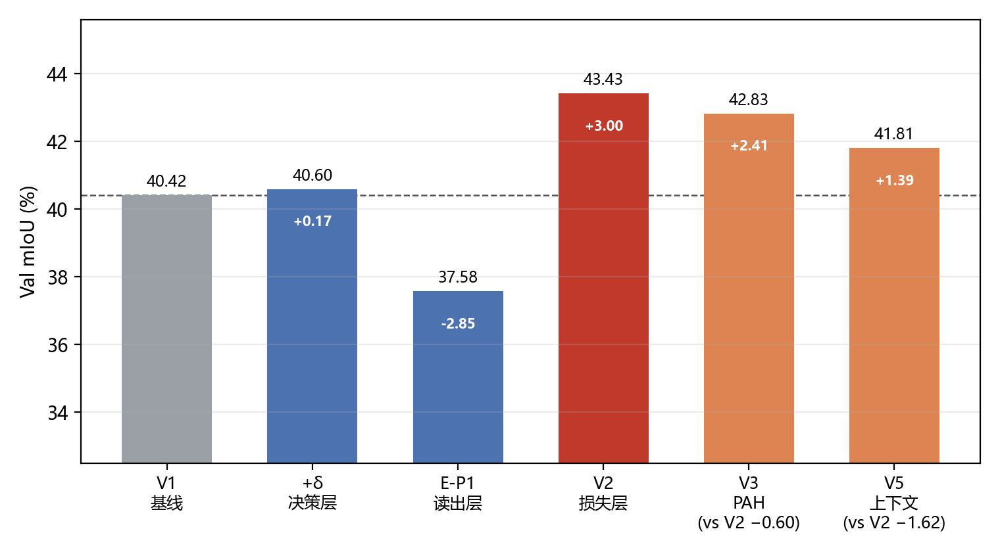

阶梯共六级，对应推理链条上的六个位置：不动（基线）、只动判决点（逐类偏置，dev上拟合）、只动读出（冻结特征与归一化统计量，仅以逆频率交叉熵重训分类头）、动损失（加权+ Dice + 边界）、动结构（两个并列变体：瓶颈接先验头V3、替换上下文聚合V5），最后回到判决点做一次一致性复核（V4）。若决策层确无余量，第六级的增益应为零。各版本的具体改动与参数量见表4-1。

这条阶梯的设计原则有两条。其一，干预位置单一：每一级只改变推理链条上的一个环节，使增益可归因。其二，成本递增：决策层零训练，读出层需数分钟，损失层需完整重训，结构层需完整重训且需重新设计模块。若低成本位置已能回收大部分余量，则无需进入高成本位置——这正是梯度的实际用途。

三点需要说明：V2是主模型，但它不是新结构，而是V1加三项损失；V3与V5是并列的两个结构变体，都建在V2之上，各只替换一处；V4不是独立模型，而是在V2上零训练地施加偏置，专门检验“决策层是否还有余量”。

**表4-1　版本系列的设计与判定对象**

| 版本 | 改动位置 | 相对前版的具体改动 | 参数量/M | 判定对象 | 设计与结果 |
|---|---|---|---|---|---|
| V1 | — | 自研轻量编解码基线，朴素交叉熵 | 3.484 | 基线误差结构 | 4.3 / 6.1 |
| V2 | 损失层 | 叠加逐图逆频率加权、Dice、边界加权 | 3.484 | 主模型；三项耦合见消融 | 4.5 / 6.3 |
| V3 | 结构·读出路径 | 瓶颈接先验感知头PAH，推理减 τ·log π̂ | 3.543 | H4 | 4.6 / 6.4 |
| V5 | 结构·上下文 | 瓶颈的SE门控替换为ASPP-Lite | 3.447 | H5 | 4.7 / 6.5 |
| V4 | 决策层 | V2加逐类偏置 δ，零训练 | 3.484 | H2的复核 | 6.2 |

表中三个结构版本（V1 / V3 / V5）的参数量分别为3.484 / 3.543 / 3.447 M，最大差异2.8%，因此它们之间的指标差可以直接归因于结构改动，而非规模变化。此外三条外部基线E10（UNet-R34）、E11（DeepLabV3+）、E12（SegFormer-B0）不参与版本迭代，只作横向参照，见6.7节。

### 4.2 参数量预算的选取

本文的全部结论都限定在一个参数预算之内。理由是：缩放研究[12] 已指出，不同资源档位对应的最优配置并不相同，因此“某结构在某规模上有效”这一命题脱离预算即无意义——预算若浮动，第6章各级干预的增益就无法横向比较，因为任何一级的增益都可能只是预算变化的副产品。故此处先说明3.484 M（6.71 GFLOPs）这一档是怎么定的。

选取它的第一层理由是可比性。实时与边缘语义分割文献中反复出现3~4 M这个档位：BiSeNetV2[9] 为3.4 M、PP-LiteSeg-T[10] 为3.6 M、MobileNetV2[7] 为3.4 M、LR-ASPP + MobileNetV3-Large[8] 为3.2 M、SegFormer的MiT-B0[5] 为3.7 M。五个独立工作在互不相同的任务、数据集与架构范式下收敛到同一量级，说明它不是某个模型的偶然取值，而是“可在边缘设备部署”这一约束在当下硬件条件下的经验解。本文取3.484 M，落在这个档位的中段；且与[5] 的官方配置（3.7 M / 8.4 GFLOPs）差距在10%以内，从而使本文与SegFormer-B0的对比具备可比性——后者的实测版本正是本文的同预算外部参照（E12）。

第二层理由是成本可承受。表4-2在结构固定的前提下只改通道宽度（深度与所有模块不变），实测了五档的算力、显存、单步时延与训练时长。3.484 M对应6.71 GFLOPs、2.12 GB峰值显存、每轮39.2 min，是单卡6 GB上“能跑完10个run与三条消融”这一实验设计所允许的档位；再往上一档（7.265 M）训练成本升到1.7倍，往下两档虽更便宜，但会脱离上述可比区间。

**表4-2　参数量预算的五档单变量缩放实测**

| 缩放系数 | 各stage宽度 | 参数量/M | GFLOPs@512² | 训练峰值显存/GB | 单步时延/ms | 30 epoch训练/min |
|---|---|---|---|---|---|---|
| 0.55 | 32/64/128/160/224 | 1.171 | 3.14 | 1.27 | 76.4 | ≈26 |
| 0.75 | 48/96/192/240/336 | 2.144 | 4.66 | 1.69 | 106.9 | ≈33 |
| 1.00 | 64/128/256/320/448 | 3.484 | 6.71 | 2.12 | 133.0 | 39.2（实测） |
| 1.40 | 96/192/384/480/672 | 7.265 | 12.46 | 2.99 | 220.4 | ≈65 |
| 1.75 | 128/256/512/640/896 | 12.513 | 20.38 | 3.87 | 277.4 | ≈85 |

第三层理由是上下界都有反例。往上，UNet-R34（24.568 M参数、36.69 GFLOPs，且编码器带ImageNet预训练）在官方验证集只得43.16，与3.484 M从零训练的V2（43.43）持平——参数多7.1倍，换来−0.27；DeepLabV3+（39.636 M）虽达50.75，但需163.57 GFLOPs（本文的24.4倍）并依赖预训练主干，已属另一个预算档，不能用来论证本文的预算应当上调。往下，同档内压缩算力是要付代价的：[8] 与[5] 的参数仅差16%，算力差4.2倍，ADE20K上相差4.3点；本文E12（3.454 M / 2.72 GFLOPs）实测39.75，同样低于V1（6.71 GFLOPs）的40.42。

最后需声明两处不确定：表4-2中0.75与0.55两档只测成本、未训练，其精度不在本文主张范围内，本文不据此外推；本文的结论应理解为“在3.484 M这一档内，改进应投向损失层”，而非“3.484 M是全局最优规模”——后者需要完整的同架构缩放曲线，本文不做此主张。

### 4.3 自研基线的设计

#### 4.3.1 设计约束

V1的设计服务于三个硬约束，它们都来自实际执行条件而非假设：参数3.484 M、算力6.71 GFLOPs（4.2节）；单卡6 GB，训练峰值显存不超过2.2 GB（实测2.12 GB）；输入1024×1024，且必须给出不低于1/4分辨率的预测——农田与道路的边界在1/8分辨率下已无法恢复，而3.2.4表明边界虽只承载4.0%的误差，却仍是判决的必要空间尺度。

V1的整体结构如图4-2：编码器为stem加四级残差stage，瓶颈接上下文模块，解码器自顶向下融合至1/4分辨率后经双线性上采样输出。V3的先验感知头与V5的多尺度上下文都标注在瓶颈处，因为二者都是对同一位置的单点替换。

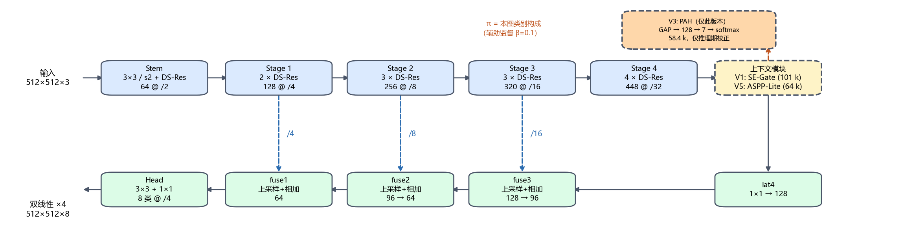

#### 4.3.2 核心设计思想：参数按算力成本反向分配

这是V1唯一“自定”的原则，也是它能用3.484 M参数撑起6.71 GFLOPs的根本原因。

推导如下：卷积的参数量正比于C_in·C_out·k²，算力正比于H·W·C_in·C_out·k²，两者只差一个H·W。也就是说，同一组参数，放在低分辨率特征图上算力成本随面积平方下降，放在高分辨率上则急剧膨胀。由此得到一条分配规则：分辨率低的地方堆参数（算力便宜），分辨率高的地方压参数（算力昂贵）。

表4-3是这条规则在V1上的实测结果。

**表4-3　V1各模块的参数量与算力分布**

| 模块 | 输出分辨率 | 通道 | 参数量 | 参数占比 | GFLOPs | 算力占比 |
|---|---|---|---|---|---|---|
| stem | 256×256（1/2） | 64 | 11 584 | 0.33% | 0.726 | 10.8% |
| stage1 | 128×128（1/4） | 128 | 71 360 | 2.05% | 1.140 | 17.0% |
| stage2 | 64×64（1/8） | 256 | 411 008 | 11.80% | 1.663 | 24.8% |
| stage3 | 32×32（1/16） | 320 | 698 944 | 20.06% | 0.709 | 10.6% |
| stage4 | 16×16（1/32） | 448 | 1 734 400 | 49.78% | 0.441 | 6.6% |
| 上下文模块 | 1×1（GAP） | 448 | 100 912 | 2.90% | ≈0 | ≈0% |
| 解码器 | 1/4起 | 64–128 | 418 496 | 12.01% | 1.424 | 21.2% |
| 输出头 | 128×128 | 8 | 37 512 | 1.08% | 0.612 | 9.1% |
| 合计 | — | — | 3 484 216 | 100% | 6.714 | 100% |

这张表可以读出三个判断。

其一，stage4拿走近一半参数（49.78%），只花6.6%的算力；而stem与stage1、stage2合计只占14.2%的参数，却消耗了52.6%的算力。参数占比与算力占比的比值，在stage4是7.5:1，在stage1是0.12:1。

其二，两个预算近似独立，不能互相替代。若把stage4的通道减半（448→224），参数可省约1.3 M，算力只省0.33 G——省参数不省算力；反之若把stage1的通道加倍（128→256），算力增加1.14 G（+17%），参数只增0.2 M——花算力不花参数。这是4.2节同时报告参数量与算力两个指标的原因：在这个结构里，它们衡量的不是同一件事。

其三，这条规则也让“加深”与“加宽”有了明确的适用位置：加宽应发生在1/16以下（算力便宜处），加深应发生在1/8以上（参数便宜处）。V1的2/3/3/4个残差块的分布（浅层少、深层多）正是按此排布。

#### 4.3.3 四个结构决策及其依据

（1）用深度可分离残差块替换标准残差块。 标准3×3卷积的参数量为C_in·C_out·9；深度可分离把它拆成逐通道3×3（C·9）与逐点1×1（C_in·C_out），参数量降到约1/8。代价是空间卷积不再跨通道混合，通道间交互全部压到1×1上完成。这一取舍在本任务上成立：地物判别的关键线索（条垄方向、田块间距、道路走向）主要是通道内的高频结构，跨通道混合在1×1处一次完成即可。量化地看，该块占全模型参数的84.0%（stem与四个stage）；若换回标准卷积，同通道下参数量会涨到24 M量级——恰好与UNet-R34的24.568 M同量级，这也解释了后者为何需要7倍参数。

（2）五级金字塔，通道64→448递增。 分辨率从512降到16（32倍），通道从64增到448（7倍）。通道必须递增，是为了让深层的感受野覆盖大目标：3.2.1已测得农田的90分位面积达18 902像素，等效边长约138像素；stage4在1/32分辨率上由4个残差块堆叠，每块含两级3×3深度卷积，理论感受野已超过500像素，足以把一整块农田收进一个判决上下文。若通道固定为64，深层无法承载这种尺度的语义，大田块会被切成碎片——这正是许多轻量模型在遥感上表现不佳的原因。

（3）解码端只融合到1/4分辨率。 这一取舍由算力而非显存决定。解码器当前已占21.2%（1.424 GFLOPs），若融合到1/2，其面积翻四倍、算力升到约5.7 G，总预算会从6.71涨到11.0 G，超出64%。剩下的4倍上采样交给双线性插值——它无参数、无算力，代价是边界精度受限。这一代价在3.2.4中已被量化：边界带只承载4.0%的误差，因此把精度预算堆在边界上并不划算。

（4）瓶颈处用SE式全局门控。 它在1/32特征图上做全局平均池化，经448→112→448的全连接生成通道权重，作用是给每个通道一个“全局重要性”，让网络知道当前这幅图整体偏向哪类地物。但它把空间布局压平成一个448维向量，无法表达“农田在东、水体在西”这类关系——这正是4.7节V5要替换它的直接动机。

#### 4.3.4 与三条外部基线的结构差异

前三点差异可以从表4-3直接读出，第四点来自实测。

UNet-R34（24.568 M / 36.69 G）以标准卷积为主、通道从64起，参数是本文的7.1倍而算力只有5.5倍——它的参数压在浅层，算力效率低。DeepLabV3+（39.636 M / 163.57 G）用空洞卷积在1/16上维持感受野，代价是ASPP的五条分支全部在1/16上以256通道并行，算力是本文的24.4倍。SegFormer-B0（3.454 M / 2.72 G）以Transformer的全局注意力替代卷积，但在2269幅的训练规模下从零训练难以收敛，实测39.75低于V1的40.42。

本文的取向可以概括为一句：参数集中在语义端、算力分散在浅层、解码端只到1/4——用尽可能少的参数换取尽可能大的有效感受野与输出分辨率。

### 4.4 两层归因框架

本文的理论支点是一条可以直接推导的等价关系。设网络输出的logit为z，类别先验为 π，则贝叶斯后验为。若训练时对类别c施加权重w_c，加权交叉熵为:

其对z的最优解满足

取对数得

上式说明：训练时的类别加权，在最优解处等价于对logit逐类加一个常数。若取w_c = π_c^(−τ)，该常数即−τ·log π_c，正是长尾学习中logit adjustment的形式[17]。因此“训练时缺少先验建模”与“推理时判决阈值偏移”描述的是同一个量：它们都作用在“logit上的逐类偏置”这一自由度上。

但两者不等价，原因在干预路径。训练时w_c出现在损失中，通过 ∂L/∂θ 改变全部参数 θ，从而改变特征映射本身——网络会把容量重新分配给被加权的类，后验形状随之一并改变。推理时只对已固定的z加常数，θ 不变，后验形状不变，改变的只是判决边界的位置。式（4-3）是在“最优解”处成立的等价，而实际训练得到的 θ 并不在最优解上，两者的差别正是本文要测量的量。

由此得两个可操作推论：若损害在决策层（形状已正确、只是判决点偏移），推理端加常数应当有效，训练时加权则不必要；若损害在表征层（形状被扭曲），推理端加常数只能整体平移，无法修复形状，而训练时加权有机会改表征——代价是它同时推动判决边界，可能引入新偏置。

两级归因由此确立：决策层（不改权重，只改判决点）与表征层（改权重，改后验形状）；读出层介于两者之间——冻结特征、只重训分类头，它检验的是“在给定后验形状下，判决函数本身还有多少自由度”。第6章的E-δ、E-P1与V2分别对应这三层。

### 4.5 V2：损失层的三项组合

V2保持V1的结构、数据、种子与训练轮数完全不变，只替换损失函数。损失由三项构成。

第一项是逐图逆频率加权。与数据集的全局类频不同，逐图权重要回答的是“这个类在本场景里稀不稀”。设第i幅裁剪中类别c的像素占比为p_c^(i)，则该类的逐图权重为

分母加 ε 避免除零，clip防止某个在图中完全缺失的类获得无穷权重。

这里存在一个必须处理的问题：逐图权重回答的是“图内稀不稀”，而重加权需要的是“在数据集中稀不稀”。若不修正，背景因在每个图内都占多数而被系统性压低权重，裸地则被系统性抬高。本文的修正是对每个类乘一个固定系数k_c，使加权后的期望损失份额与该类在训练集中的真实份额对齐：

系数k_c由6806个训练裁剪统计标定，取值分别为背景0.871、建筑1.241、道路1.487、水体1.589、裸地2.013、林地1.136、农田1.290。需要说明clip施加在缩放之前，因此对齐后的有效权重范围为0.44–6.72。在150个独立裁剪上的校验显示，加权后的损失份额（依次为背景、建筑、道路、水体、裸地、林地、农田）为24.2/10.7/9.4/9.0/7.4/19.2/20.2，目标份额为23.7/13.2/9.3/10.3/9.5/16.0/18.2，差别落在抽样噪声内。

第二项是Dice损失[15]，直接优化预测区域与真值区域的重叠度，对前景像素极少的类尤为有效。第三项是边界加权：先由真值图提取类别边界带，对落在边界带内的像素将交叉熵权重乘以 (1+λ_b)，本文取 λ_b = 1.0，边界带宽度3像素。三项合并为

需要强调，V2的三项是同时开启的组合，而不是三个独立改进的简单叠加。第6.3节的单因素消融表明，三项单独使用的效果之和与组合效果相差一个量级，因此不能把V2的增益按项拆分。

### 4.6 V3：先验感知头与逐图先验校正

V3在V2的瓶颈处接出一个先验预测分支（PAH），用于估计该幅影像的类别构成，并在推理时对logit做逐类校正（图4-2中标注于瓶颈）：

PAH仅增加58.4 k参数（3.543 M，+1.65%）。这里选择全局平均池化而非空间注意力，是因为PAH要估计的是“这幅图的类别构成”这一组标量统计量，与像素位置无关；若引入空间注意力，π̂ 会退化为另一份分割图，反而失去“构成”的含义。式（4-8）的符号方向需要说明：减去log π̂ 是去除先验（logit adjustment），而非贝叶斯后验（后者应为加上log π）。由于softmax对逐样本常数不变，真正起作用的只是类间差，因此 τ 的物理含义是“去先验的强度”。

训练与推理存在有意的不对称：主损失使用未校正的logit，校正只在推理时施加。若训练时也施加校正，网络可以学成“π̂ 与z相互抵消”的退化解，使 π̂ 失去意义。π̂ 由一项辅助损失监督（构成交叉熵，权重0.1），使其逼近该图的真实类别构成。

从4.4节的框架看，V3的位置介于决策层与表征层之间：它增加了一条从特征到先验的读出路径（改变参数），但校正本身仍然是logit上的逐类偏置（不改后验形状）。这一设计的目的即检验H4——若决策层确有余量，且余量随影像构成变化，则逐图先验应优于全局先验。

### 4.7 V5：等参数的上下文聚合替换

V5在V2上只改一处：把瓶颈的通道门控整体替换为多尺度空洞卷积（ASPP-Lite）。

原模块为GAP → FC(448→112) → FC(112→448) → Sigmoid → 逐通道相乘，参数量100.9 k。替换后的模块为三支空洞率分别为1、2、4的深度可分离卷积与一支全局池化并联，四支取均值后经批归一化与ReLU，接1×1分组卷积（groups=4）降维，再经批归一化后与输入残差相加，参数量64.1 k。空洞率的取值不是调参得来的，而是由3.2.1的尺度统计反推：在1/32特征图上，3×3空洞卷积在d = 1、2、4时的有效核分别覆盖约96、160、288像素，加上全局支路，四条通路恰好铺满农田的尺度带（等效边长约138像素）及其两倍邻域。

设计有三点约束。其一，等参数：V5为3.447 M，比V2低1.06%，从而使“参数变多导致变好”这一替代解释在设计层面被排除。其二，保留全局支路：若完全去掉GAP，则“换聚合方式”会混入“失去全局信息”，两者无法区分。其三，改动是模块级而非成分级：V5同时去掉了SE门控、加入了多尺度空洞卷积与残差，因此结论只能表述为“替换聚合方式的效果”，不能拆到单一成分。若要拆分，需按预注册条件触发控制实验V5-ctl，本次未触发（实测差值−1.62，远超0.5的触发阈值）。

## 5 实验设置与评价口径

本章交代训练与评测的全部设置，并明确哪些数值差异不足以支撑结论。后文所有“有增益/无差异”的判断，都以此处确定的阈值为准。

### 5.1 训练与评测配置

全部10个run（V1、V2、V3、V5、三条外部基线、三条单因素消融）使用同一套训练配置（表5-1），仅损失函数与网络结构按设计变化。这一约束是可归因的前提：若各run的超参不同，跨run的差值就无法归因于结构或损失。

**表5-1　训练配置**

| 项目 | 设定 |
|---|---|
| batch | 8（E10受显存限制改用梯度累积，等效batch 8） |
| 优化器 | AdamW[22]，lr 6e-4，weight decay 0.01 |
| 调度 | 余弦退火[23]，30 epoch，无warm restart |
| 精度 | 混合精度（AMP） |
| 梯度裁剪 | 1.0 |
| 随机种子 | 42 |
| 选点 | 每轮在dev上监控，保存最优；验证集不参与任何选择 |
| 框架/硬件 | PyTorch，单卡RTX 3060（6 GB） |

单轮训练时长36.6–47.9 min（3.4 M档，含每轮dev监控）、54.9 min（E10）、125.2 min（E11）。

评测严格按3.1节所述协议执行，所有报告值均出自该流程。此处只强调一点：不使用训练期的512 center-crop监控值。两者相差可达1点以上，混用会产生“同一模型三个分数”的假象。

### 5.2 指标与统计口径

主指标为mIoU。选择mIoU而非OA的理由是：在6.7:1的长尾下，把全部像素判为背景即可获得约35%的OA，OA对少数类完全不敏感。辅助指标中，mF1与mIoU高度相关但更易受小类影响，逐类精确率与召回率用于判断误差方向（过度预测还是欠预测），混淆矩阵用于定位误差流向。

本文的结论强度受单种子限制，因此必须先确定“多少点以内不应解读”。本文用同一run内不同检查点在验证集上的差值来标定这一阈值：V1的最优检查点与第30轮检查点相差−0.17，V2相差−0.65，均值0.41、最大0.65。由此确定三条口径：验证集上小于0.65的差值不作解读；dev因样本量少一个量级，阈值放大到1.5；两个不同训练run之间的比较同样适用0.65。后文的全部“有增益/无差异”判断均以此为准。

### 5.3 三项须披露的事实

第一，基线初始化不对称。E10/E11用ImageNet预训练编码器，E12与自研版本从零训练。该差异对E10/E11有利，故本文对比是保守的；但也不能用“参数更少而精度相当”主张架构优势，因为预训练的贡献无法分离。

第二，检查点由dev选定，验证集只报告一次。这避免了“在验证集上挑最好一轮”的选择偏差，代价是dev与训练集同源（99.6%的dev影像在训练集中有空间邻居），dev指标偏乐观。本文据此刻意不用dev的绝对值论证任何结论，只用它做域间对照（因为两个域受同样的偏差影响）。

第三，效率指标只作参考。参数量与GFLOPs是硬件无关的量，而FPS在单张推理、GPU动态频率、CPU启动开销主导的条件下波动极大。本文在冷态会话中测得V1仅45 FPS，而在热态评测末尾测得169 FPS。因此第6.6节的时延数据全部来自同条件交替实测，且明确标注测量前提。

## 6 实验结果与分析

本章按“基线—判定三层—定位落差—横向对比”的顺序展开，不按版本号平铺。各小节依次对应第3.3节的假设。

### 6.1 基线V1的性能与误差结构

V1在官方验证集取得mIoU 40.42、OA 61.45、mF1 56.75，分域为城区44.95、乡村35.36；在dev上取得56.69。表6-1给出逐类指标。

**表6-1　V1在验证集上的逐类指标（%）**

| 类别 | IoU | 召回 | 精确率 | 判读 |
|---|---|---|---|---|
| 背景 | 48.77 | 74.90 | 58.30 | 过度预测 |
| 建筑 | 49.70 | 70.00 | 63.16 | 基本均衡 |
| 道路 | 45.51 | 54.76 | 72.94 | 保守 |
| 水体 | 38.49 | 59.74 | 51.98 | 双向错误 |
| 裸地 | 18.02 | 20.30 | 61.58 | 严重欠预测 |
| 林地 | 37.92 | 60.42 | 50.45 | 双向错误 |
| 农田 | 44.54 | 50.67 | 78.66 | 保守 |

两个现象值得注意。其一，裸地是最短板，IoU仅18.02，且形态是“召回20.30、精确率61.58”——模型几乎不敢预测裸地，而不是乱预测。其二，同一类别在两个域上错误方向相反：裸地在dev上召回54.4、精确率46.3（过度预测），在验证集上召回20.30、精确率61.58（欠预测）。因此“不平衡损害少数类”这一笼统说法在本数据上不成立；准确表述是“跨域使少数类从过度预测翻转为欠预测”。这一观察是后续全部分析的起点。

图6-1给出V1（左）与V2（右）的验证集混淆矩阵，按行归一化，格内数值为%。V1的误差高度集中于“真值为少数类、被判为背景”的方向，被判为背景的像素占全部误差的50.2%（dev上为41.7%），即背景充当了误差吸收器。这一统计同时完成了H1的第二个判据：背景吸收误差成立，但其成因不在边界——3.2节已证明边界带只承载4.0%的误差。

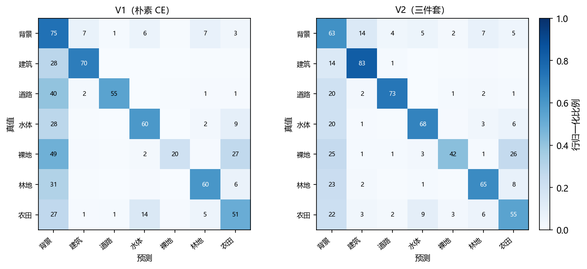

### 6.2 决策层与读出层的余量（H2、H3）

本节连续检验两层：先看判决点是否画错（H2），再看少数类信息是否已在特征里（H3）。两项结果合并于表6-2。

H2的检验是E-δ：在完全不改变权重的条件下，为7类logit加常数偏置，参数化两种：先验形式（δ_c = −τ·log π_c，仅搜 τ）与自由形式（7个 δ_c独立搜）。偏置在dev上拟合，原样搬到验证集，另在验证集上自拟合一次作为作弊上界。

**表6-2　决策层与读出层的干预结果**

| 干预 | 设置 | dev | 验证集 | 相对V1 |
|---|---|---|---|---|
| E-δ | 先验形式，最优 τ | τ* = 0 | — | 0.00 |
| E-δ | 自由形式（7参数，dev拟合） | 56.89（+0.30） | 40.60 | +0.17 |
| E-δ | 验证集自拟合（作弊上界） | — | 42.06 | +1.67 |
| E-P1 | 冻结特征，重训末层读出（520参数） | 51.31（−5.38） | 37.58 | −2.84 |
| E-P1 | 同上，重训整个头部（37512参数，72×） | — | 37.19 | −3.23 |

先验形式的 τ 扫描在dev上单调下降：τ = 0时56.59，0.25时56.25，0.5时54.62，1.0时49.04，2.0时39.69。最优解就是 τ = 0，即“校正完全不起作用”。自由形式在dev上只拟合出+0.30，迁移到验证集后只剩+0.17，远低于1.0的判据阈值。即便在验证集上作弊拟合，上限也只有+1.67，约占总落差16.27的10%。

H2不成立。 决策层几乎没有可回收余量，问题不在判决点。

判决点既然不是问题，下一个问题是：少数类的信息是否已经在特征里。E-P1冻结V1的全部特征与归一化统计量，仅用完全逆频率的交叉熵重训分类头8轮——若信息已在特征中，仅改读出就应显著回升。

结果与假设方向相反但幅度确切：验证集mIoU降至37.58（−2.84），dev降至51.31（−5.38）。但逐类看，裸地IoU从18.02升至27.96（+9.94），召回从20.30升至46.7；代价是背景−13.19、建筑−10.93。也就是说，裸地的信息确实编码在特征里，否则只改读出不可能有近10点的回升；但读出任何向少数类的倾斜都要以多数类为代价。

这一结果有一个显然的替代解释：末层读出只有520参数，或许不是“读不出来”而是“容量不够”。为此把读出扩大到整个头部（37512参数，72倍），其余设置完全相同。结果进一步降至37.19（−3.23），裸地27.6、背景32.5。72倍的容量把结果做得更差，因此“读出层太小”被排除。

H3成立，但需精确表述：不是“特征不可分”，而是“判别的可分性不足”——少数类信息与多数类信息在特征空间中相互纠缠，任何读出方式都必须在两者之间取舍。这一措辞同时解释了为什么E-δ 无效（不是判决点问题）和为什么必须动表征。

需要声明该实验的边界：被冻结的特征本身由朴素交叉熵训练而来，带任务偏置；E-P1测量的是“在已有特征上的线性读出上限”，不是数据的贝叶斯上限。

### 6.3 V2与它的真实来源

V2在验证集取得43.43，相对V1提升3.00，OA 62.37，mF1 60.26，城区49.52（+4.57）、乡村36.14（+0.78）。逐类看，裸地+12.00（30.02）、水体+9.54（48.04）、道路+3.81、农田+3.57，而背景−2.79、建筑−6.20。

但dev上仅提升0.06，落在噪声带内。凡引用+3.00必须同时给出+0.06，否则会被读成“损失层提升了分割能力”。真实情况是：同一组权重在两个域上做的都是“把操作点整体推向少数类”——在验证集上那里原本把裸地压得极低（召回20.3），同样的移动正好补上缺口；在dev上裸地本就被过度预测，移动只完成类间再分配（背景−8.3、裸地+1.4，七类代数和约为零）。

为判断+3.00的来源，本文做了三条单因素消融，每条只在V1上开一项（表6-3）。

**表6-3　V2三项损失的单因素消融与交互项（验证集 / dev）**

| 实验 | 干预 | 验证集mIoU | Δ vs V1 | dev | Δ vs V1 |
|---|---|---|---|---|---|
| V1 | 朴素交叉熵 | 40.42 | — | 56.69 | — |
| AB_w | + 逐图加权 | 39.89 | −0.53 | 55.25 | −1.44 |
| AB_dice | + Dice | 41.72 | +1.30 | 58.21 | +1.52 |
| AB_bnd | + 边界加权 | 39.37 | −1.05 | 56.57 | −0.12 |
| — | 三项之和 | — | −0.28 | — | −0.03 |
| V2 | 三项全开 | 43.43 | +3.00 | 56.75 | +0.06 |
| — | 交互项（组合−之和） | — | +3.29 | — | +0.09 |

三项单独使用的效果分别是负、正、负，而组合为正且大于任何单项。逐类机制可以解释这一分工：逐图加权像“推力”，把裸地召回从20.3翻倍到40.2，但精确率从61.6崩到39.4，背景IoU掉8.4，净−0.53；Dice像“约束”，裸地精确率维持60.9，背景几乎不动（48.77→48.21），净+1.30；边界加权像“刹车”，方向与加权相反，裸地召回反而降到17.0、精确率升到65.3，净−1.05。

V2同时拿到召回42.35与精确率50.77——召回高于纯推力（40.15），精确率也高于纯推力（39.36）。若只是“推+ 刹车”的折中，召回应落在40.2与17.0之间，但实际更高。这是叠加效应而非线性混合。

图6-2把这一对比并置呈现：三项之和−0.28，而组合为+3.00，交互项+3.29。

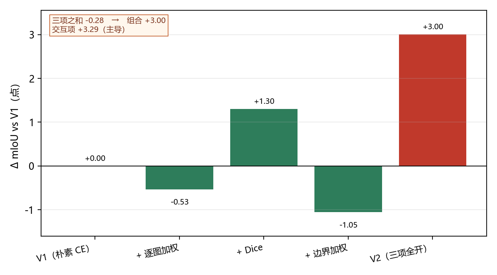

表6-3右侧一列是本文最需要注意的对照：同样三项，在dev上交互只有+0.09，几乎为零。 即这个耦合是跨域专属的：同分布上三项合起来（+0.06）甚至不如只加Dice（+1.52）；跨域上三项合起来（+3.00）远超任何单项（最好+1.30）。这与6.6节的rural发现直接咬合——验证集上的增益主要来自乡村降幅从23.18收窄到20.76，而乡村恰是误差流向发生反转的地方；加权把预测推向农田与水体，Dice与边界项约束它不要溢出，三者同时作用才在那种场景下成立。同分布里没有这种流向反转，所以组合毫无额外收益。

须同时声明三点：三项之和为−0.28，故不能相加当作V2的分解；AB_bnd的−1.05只是单项效应，且其边界图仅覆盖1.53%的像素，在组合中的角色无法由单项结果反推；本文未做2³ 全因子，故不能判断哪两项的交互最关键。

### 6.4 V3的负结果与三条机制（H4）

V3不校正时验证集42.83，比V2低0.60。先验头的估计质量是合格的：π̂ 与真实构成的MAE在dev上为0.0491，其与训练集先验的偏差（0.123）远大于与真值的偏差（0.049），说明它在跟踪逐图构成而非停在数据集先验上。

但任何强度的校正都使指标下降。图6-3给出四种先验来源的 τ 曲线（左dev、右验证集，虚线为不校正时的mIoU）：两域均单调下降，dev上连 τ=0.05都比不校正低0.40；按预注册“τ 在dev上选”，得到 τ* = 0。更关键的是三种先验来源的排序：

逐图先验（pred）在所有 τ 上都劣于全局先验（global）：dev上 τ=0.25时53.59对54.06，τ=1.0时37.61对47.20。而用真值构成的上帝视角（oracle）同样劣于不校正：验证集上oracle的最好成绩只有38.76，低于42.83。这说明问题不在 π̂ 不够准——换成精确先验依然是负收益，问题在“校正”这件事本身。

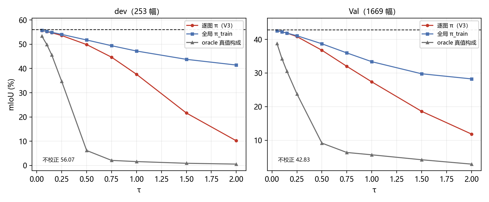

三条机制均可量化。

其一，概率域的小误差在log域是巨误差。π̂ 的概率域平均绝对误差只有0.049，但校正在log域进行。逐类分解显示，裸地的“真实逐图差异 / 估计误差”信噪比仅0.79——信号比噪声还小，而裸地恰是最需要校正的类；背景信噪比最高（2.74）却无需校正。根源是缺失类：每幅影像平均有2.34个类完全缺失（真值占比为0），π̂ 仍给它们平均0.024的概率质量，这一小误差在log域是9.3 nats。

其二，π̂ 基本是模型自身输出的复述。在80幅dev影像上，π̂ 与模型自身预测份额的相关系数达0.980，控制住模型份额后，π̂ 对真值的偏相关在裸地上为−0.402（方向相反）。这意味着校正力度与需要的力度负相关：模型认为裸地少时 π̂ 也说裸地少，于是需要抬的地方恰好抬得最少。

其三，V2已经校正过一次。π̂ 的均值与真值均值逐类差不超过0.04，说明V2的逆频率加权早已把先验偏置压掉，V3在其上再减一次log π̂ 就是二次校正。这解释了为什么连全局先验都掉分：不是“全局先验好”，而是“任何去先验操作都过头”。

H4不成立。 需要说明，V3不校正时比V2低0.60这一点未做多种子检验，可能含种子噪声；但上述三条机制是同一组权重上的确定性计算，不受噪声影响。

### 6.5 V5的镜像现象与机制（H5）

V5在验证集取得41.81，相对V2下降1.62；但在dev上取得57.22，相对V2上升0.47。两个域方向相反：跨域退化1.62远超0.65的噪声带，同分布+0.47虽落在dev的1.5噪声带内，但方向与前者相反，构成一个必须解释的现象。

这构成一组镜像：V2相对V1只买到跨域（dev +0.06 / 验证集+3.00），V5相对V2只买到同分布（dev +0.47 / 验证集−1.62），而V3两边都没买到。其机制并不复杂。V5保留空间布局后，预测重新被空间上占优的主类吸走（道路+2.88、农田+1.28），这恰好抵消了V2把预测推向少数类的效果：V2花3.00换来的裸地（30.02）与水体（48.04），被V5退回25.09与43.99。两者作用在同一根杠杆的两端。

机制测量（图6-4，份额指预测为该类的像素占全部有效像素的比例）显示，V5唯一稳定的作用是抽走裸地的预测份额、抬高农田：dev上裸地份额由8.27%降至6.53%（−1.74 pp），验证集上由3.55%降至1.98%（−1.57 pp），两域一致。

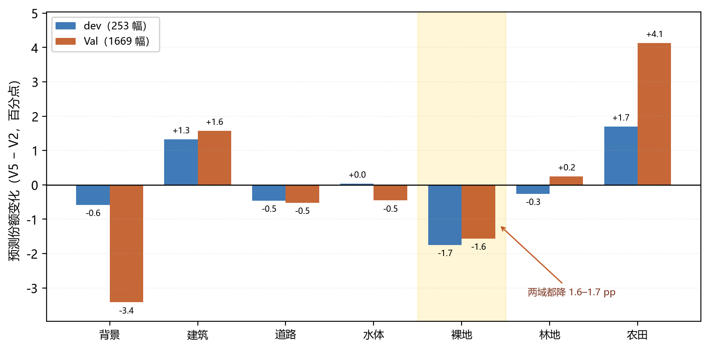

同一个动作在两个域上结果相反，原因在起点不同。dev上V2的裸地召回已达80.6（精确率仅38.0），此时抽掉份额等于修正过度预测，精确率升5.7，IoU净涨2.85；验证集上V2的裸地召回只有42.3，抽掉份额使召回跌到29.4，精确率虽升到63.0也补不回来，IoU净跌4.93。dev的+0.47与验证集的−1.62是同一个机制的两面，而非两个模型在做不同的事。

本文还否证了一个听起来顺理成章的解释。原假设是“ASPP-Lite保留空间布局 → 预测更顺从大片同质区 → 小块目标被吞”，其中介变量应为“块状化”。实测不支持：3×3邻域同标签比例在dev上升0.21个百分点、在验证集上反而降0.15；每图连通域个数在dev减少8.8、在验证集增加11.2。两个域方向相反，而若块状化是中介，两域应当同向。中介变量是类别份额的转移，不是空间形态。

H5不成立。 三条预注册判据全部未达：验证集要求 ≥ V2+1.0，实测−1.62；机制门槛要求背景/农田/林地任一召回+5，实测为+1.5 / +3.5 / −3.5。条件对照实验V5-ctl未触发。

### 6.6 跨域落差的真实位置

前述所有分析都建立在“dev与验证集之间存在16.27的落差”这一前提上。本节对这一前提本身做分解，结论是本文最重要的发现之一。

分别统计七个模型在两个域上的分域mIoU（表6-4）。

**表6-4　七个模型的域间落差分解（dev → 验证集）**

| 模型 | dev城区 | 验证集城区 | Δ 城区 | dev乡村 | 验证集乡村 | Δ 乡村 |
|---|---|---|---|---|---|---|
| V1 | 44.66 | 44.95 | +0.28 | 58.54 | 35.36 | −23.18 |
| V2 | 48.34 | 49.52 | +1.17 | 56.90 | 36.14 | −20.76 |
| V3 | 47.20 | 49.77 | +2.56 | 56.47 | 35.93 | −20.54 |
| V5 | 47.21 | 47.98 | +0.76 | 58.15 | 35.01 | −23.14 |
| E10 | 44.33 | 46.81 | +2.48 | 57.20 | 36.27 | −20.93 |
| E11 | 59.58 | 55.76 | −3.82 | 66.21 | 42.82 | −23.39 |
| E12 | 41.06 | 41.91 | +0.85 | 55.98 | 35.68 | −20.30 |

城区子集在域间几乎不动（−3.8~+2.5），乡村子集一致下降20.3~23.4。 此前被笼统称为“跨域落差”的现象，实际上几乎全部来自乡村。这一规律在参数量相差11倍的模型上同样成立，说明它不是某个架构的特性。

乡村为何失效，需单独检验。最直接的解释是先验漂移：把验证集的混淆矩阵按dev与验证集的类频比值逐行缩放（相当于假设验证集的类别构成与dev相同），重算mIoU。结果全量上先验漂移只能解释+1.38（占落差9%），而在乡村子集上解释量是 −0.54（−2%）——把构成对齐后指标反而更差。

这一反直觉结果的根源是指标性质：mIoU是宏平均，单类IoU = TP/(TP+FP+FN) 与类别像素数无关，因此“类别构成变了”本身不会改变mIoU。用L1距离可以直接验证：城区两域的构成差异（0.746）远大于乡村（0.448），但城区的性能几乎不变。结论是：乡村的20点以上落差约100%来自“同一类变得更难分”，不是先验问题，故也不可能靠重加权或阈值修好。

图6-5给出落差分解与先验贡献的对照。

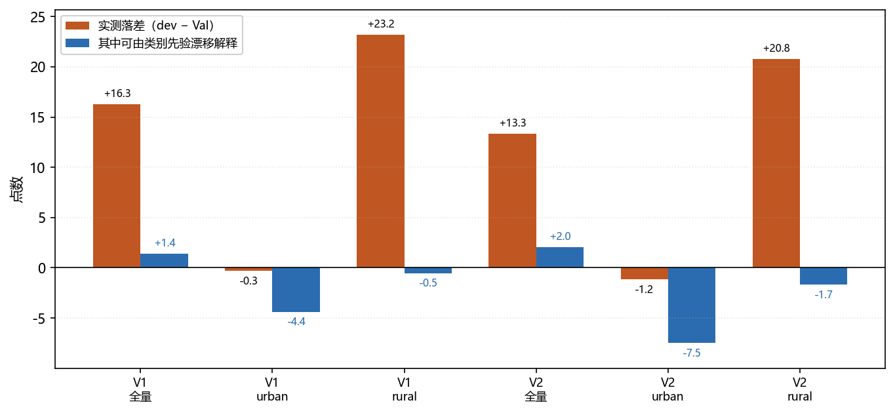

逐类看（V1，dev → 验证集），只有背景上升5.2，其余六类全部下跌，以林地−48.2、水体−38.2最重。误差流向整体反转：dev乡村主要错在“背景→农田”（25.6%），验证集乡村变成“农田→背景”（20.3%）与“农田→水体”（16.4%）。方向完全相反。这也解释了V2为何能把乡村降幅从23.18压到20.76：它抬高了少数类的操作点，恰好对上验证集乡村的“农田→背景”流向。

既然落差集中在“农田→背景/水体”这一条流向上，本文对它做了一次专项核查，以判断它是否属于可回收的余量。核查对象是V2在992幅乡村图上的全分辨率预测：该流向涉及乡村农田像素的38.2%，其中65.6%判为背景、34.4%判为水体。三项形态测量先排除了“边界或细结构丢失”：57.8%的错判像素距农田边界超过80像素（判对组51.2%），93.5%落在5×5腐蚀后的核心区内，97.6%属于面积超过3万像素的整块农田——错判发生在整片农田内部，而非田埂与水渠的交界。

光谱测量给出了另一种解释：错判像素的平均亮度为65.8（判为背景）与57.1（判为水体），比判对的农田像素（80.4）低15–23个灰度级；NDWI分别为0.163与0.272，判对组仅0.040。按“NDWI大于0.15或亮度低于70”判定，83.8%的错判像素具备明显的水体或暗地表特征（判对组34.0%）。这说明模型判成背景或水体在光谱上有依据，而标注按土地利用口径仍记为农田——灌水期的水田、低洼易涝的田块都属农业用地，但其地表覆盖确实是水。据此本文作出否定性判断：这部分落差中约八成为标注语义与可学特征的口径错位，不属可通过提高分辨率、加强边界约束或统计对齐回收的余量；剩余约两成的上限对应总mIoU不足1点，落在噪声带内。因此不再沿此方向迭代，其失效边界记入7.4节。

### 6.7 多模型对比与预测可视化

表6-5给出7个模型在验证集上的精度，表6-6给出规模与速度。

**表6-5　七个模型的精度对比（验证集，%）**

| 模型 | 参数/M | 初始化 | mIoU | OA | mF1 | 城区 | 乡村 | 裸地IoU |
|---|---|---|---|---|---|---|---|---|
| V1 | 3.484 | 从零 | 40.42 | 61.45 | 56.75 | 44.95 | 35.36 | 18.02 |
| V2 | 3.484 | 从零 | 43.43 | 62.37 | 60.26 | 49.52 | 36.14 | 30.02 |
| V3 | 3.543 | 从零 | 42.83 | 61.48 | 59.56 | 49.77 | 35.93 | 29.49 |
| V5 | 3.447 | 从零 | 41.81 | 61.18 | 58.46 | 47.98 | 35.01 | 25.09 |
| E10 UNet-R34 | 24.568 | ImageNet | 43.16 | 64.94 | 59.42 | 46.81 | 36.27 | 27.53 |
| E11 DeepLabV3+ | 39.636 | ImageNet | 50.75 | 69.16 | 66.18 | 55.76 | 42.82 | 24.39 |
| E12 SegFormer-B0 | 3.454 | 从零 | 39.75 | 60.93 | 55.62 | 41.91 | 35.68 | 12.59 |

**表6-6　规模与速度（FP16，batch 1，512²）**

| 模型 | 参数/M | GFLOPs | 单图时延/ms | FPS |
|---|---|---|---|---|
| V1 | 3.484 | 6.71 | 6.0 | 165.8 |
| V2 | 3.484 | 6.71 | 5.9 | 169.0 |
| V3 | 3.543 | 6.71 | 6.5 | 154.6 |
| V5 | 3.447 | 6.73 | 6.3–6.4 | 156–159 |
| E10 UNet-R34 | 24.568 | 36.69 | 12.3 | 81.5 |
| E11 DeepLabV3+ | 39.636 | 163.57 | 33.0 | 30.3 |
| E12 SegFormer-B0 | 3.454 | 2.72 | 8.7 | 114.4 |

由此可以给出三组可辩护的对比。

第一，同参数预算（V1对E12，均从零、均纯交叉熵）：验证集+0.67（噪声带内），dev +2.85。V1的优势在同分布，跨域上持平。

第二，对UNet-R34：V2为43.43，E10为43.16，差值+0.27落在噪声带内。3.484 M从零训练与24.568 M加ImageNet预训练精度持平，参数少7.1倍。 但必须同时指出：E10的OA更高（64.94对62.37），说明两者的误差分布不同——V2用一部分多数类精度换取了少数类精度。

第三，唯一被大幅超过的是E11：50.75对43.43（+7.32），代价是163.57 GFLOPs（24.4倍）与预训练主干。但即便面对11倍参数的模型，V2在裸地IoU上反而更高（30.02对24.39），说明针对极稀有类的加权的确有效。

图6-6以参数—精度散点呈现这一格局（气泡面积为参数量；同骨干的7个点算力均为6.71 GFLOPs，横向错开仅为可读性）：本文的四个版本集中在3.4 M竖线上，V2位于该线的最高点，并与24.568 M的E10在同一水平线附近。

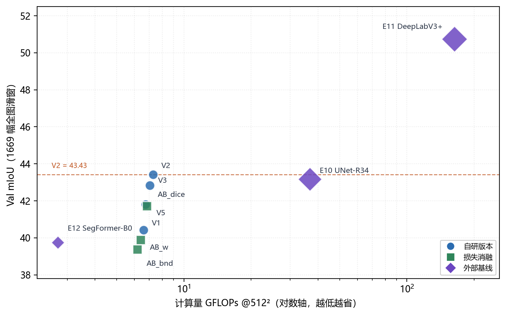

除统计对比外，图6-7另给出两组典型样例（上排城区、下排乡村；各列为原图、真值、V1、V2、V3、V5与DeepLabV3+，列标题给出该图的mIoU），按7类齐全且V2相对V1提升显著的标准挑选。

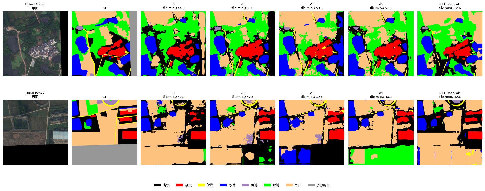

必须注明：这两组是挑选的典型成功案例，不代表平均表现。 同批60张乡村图上，V2相对V1的逐图平均增益只有+0.4，远低于图中两例的+10.7与+7.6，可见挑选放大了观感。图6-7的作用是展示V2在裸地、水体等少数类上的判别形态变化，而非证明V2普遍更好——后者以本节前面的统计结果为准。

### 6.8 与机器学习基础概念的对应

表6-7汇总本文各环节与机器学习基础概念的对应关系，每一行都可指认到具体章节、公式或图表。

**表6-7　基础概念与本文的对应关系**

| 概念 | 本文如何用 | 位置 |
|---|---|---|
| 神经网络结构设计（编解码、感受野、参数—算力权衡） | 自研V1：参数集中于低分辨率、算力分散于浅层；深度可分离残差替代标准卷积 | 4.3.2、表4-3、图4-2 |
| 上下文聚合与多尺度（空洞卷积/ASPP） | V5以空洞率1/2/4的三支卷积替换SE门控，取值由尺度统计反推 | 4.7、图4-2 |
| 激活函数（ReLU/Sigmoid/Softmax） | 残差块用ReLU，门控用Sigmoid，输出与 π̂ 用Softmax | 4.3、4.6 |
| 损失函数设计（CE/Dice/组合） | V2的CE+Dice+边界加权（α=0.5） | 4.5、式4-6 |
| 反向传播与梯度加权 | 逐图权重作用于CE梯度；解释训练加权为何改表征 | 4.4、式4-3 |
| 类别不平衡处理 | 逐图逆频率加权+ 份额对齐k_c | 4.5、表6-3 |
| 贝叶斯决策与先验偏移 | 两层归因：加权CE最优解等价于logit加常数 | 4.4、式4-2 |
| 特征表示与可分性 | E-P1冻结特征重训读出，测判别可分性 | 6.2 |
| 正则化与防过拟合 | 批归一化、权重衰减0.01、随机缩放0.75–1.5 | 5.1 |
| 超参数与训练策略 | lr 6e-4 + 余弦退火30轮+ AMP + 梯度裁剪1.0 | 5.1、表5-1 |
| 优化器 | 全部实验统一AdamW | 5.1 |
| 评价指标 | mIoU主报；说明OA在长尾下的误导性 | 5.2、表6-1 |
| 模型容量与泛化 | 五档参数扫描+ E10/E11的容量反例 | 4.2、表4-2 |
| 迁移学习与域适应 | 预训练差异披露；乡村单侧失效；BN重估列未来工作 | 6.6、5.3 |
| 采样与数据划分 | dev分层10%抽取；99.6%空间邻居的泄漏声明 | 3.1、5.3 |

## 7 讨论

本章把第6章的四项判定合成为一条结论链，解释互斥现象为何发生、为何与容量无关，并交代这套结论的边界。

### 7.1 三层结论的闭合

把六级干预的收益按位置排列，得到一条单调而清晰的图景：决策层两次干预（E-δ 的+0.17、V4的+0.00）都为零；读出层（E-P1）为−2.84；损失层（V2）为+3.00，但其中真正的“能力”部分只有Dice带来的+1.30，其余来自与操作点校正的耦合；结构层的两次尝试（V3的−0.60、V5的−1.62）都退回V2之下。

这条图景回答1.2节提出的问题：在这个数据与这个预算下，损害不在判决点，而在表征；但表征的修复不能靠“给分类头更多自由度”，只能靠改变梯度的塑形方式，且这种修复只在跨域兑现。

值得注意的是，决策层零收益这一结论有三条独立路线支持（阈值校正、冻结特征重训读出、带逐图先验的校正头），且第三条在给定真值先验的上帝视角下仍为负。这种“多路线同向”比单点数值更有说服力，因为它排除了“某一种实现没调好”的解释。

### 7.2 互斥的成因

V2只涨跨域，V5只涨同分布，V3两边都跌。表面上这像是“增益守恒”，但6.3节的消融给出了更精确的图景：互斥发生在结构件层面，而不是任务定律。

证据是Dice单项在两个域上同涨（dev +1.52、验证集+1.30），它是真正的能力增益；而逐图加权在dev上是−1.44、在验证集上是+1.30，它做的是操作点移动。V2的dev增益+0.06恰恰是“能力+1.52被操作点移动−1.44抵消”的结果。因此“互斥”至少依赖“改哪一层”：改损失函数可以买到部分两域同涨，改上下文聚合则只能在两域间二选一。

这一区分对实践有直接含义：若目标是单一部署域，结构改动值得尝试；若目标是跨域泛化，损失层的组合比结构替换更可能奏效。

另一条需要排除的解释是容量：乡村失效或许因为3.4 M不够大。本文用三个量级的模型检验这一点。3.447 M（V5）、24.568 M（E10）、39.636 M（E11）的乡村降幅分别为23.14、20.93、23.39，不随容量单调变化；E11参数量是V1的11.4倍，乡村降幅反而略大于V1（23.39对23.18）。同样，三者的城区变化为+0.76、+2.48、−3.82，也无规律。

因此容量在本数据上起到的是“整体平移”而非“改善迁移”的作用：它能抬高两个域的绝对水平（E11的dev达65.83），但不能缩小域间落差。这与6.6节的结论一致——落差来源于乡村子集的条件分布变化，而条件分布的变化不是靠增加参数就能补偿的。

### 7.3 方法学反思

第一，mIoU的宏平均性质使“先验漂移”这一解释在指标层面几乎不可能成立。在分解落差之前，“验证集类别构成不同导致指标下降”看似合理且被广泛接受，但单类IoU与类别像素数无关，构成变化本身不改变mIoU。若不澄清这一点，很容易把先验偏移误认为落差的主因，进而把工作引向重加权与阈值调整——而本文已证明那条路没有余量。

第二，单种子限制。本文所有结论都建立在一次训练之上，因此凡 |Δ| 小于0.65一律不作解读。这一阈值由同一run内不同检查点的差值实测标定，而非拍定。代价是：AB_w的−0.53落在噪声带内，只能说“方向为负”而不能说“显著为负”。缓解证据是三条单项在两个域上方向一致，这种一致性比单点数值更能抵抗噪声。

第三，消融的粒度。本文做的是“单项+ 组合”的四点设计，只能给出总交互项，无法分离二阶与三阶交互。要拆分需2³ 全因子（8条 × 约47 min），本轮未做。因此本文不能回答“哪两项的交互最关键”，只能回答“收益的主体在交互项上”。

### 7.4 局限与失效边界

表7-1给出五个假设的判定结果、关键证据与失效边界（判据本身见表3-2）。

**表7-1　五个假设的判定汇总**

| 假设 | 判定 | 关键证据 | 失效边界 |
|---|---|---|---|
| H1 | 边界一条不成立；背景吸收误差成立 | 边界带占2.7%像素、仅承载4.0%误差；被判为背景占误差41.7%/50.2% | 边界带宽度取3 px，更宽带可能改变占比 |
| H2 | 不成立 | dev自由形式+0.30、先验形式 τ=0、验证集上界+1.67 | 若先验差异更大（如跨传感器），结论可能反转 |
| H3 | 成立（判别可分性不足） | E-P1 −2.84，72× 容量后−3.23 | 冻结特征带朴素CE偏置，非贝叶斯上限 |
| H4 | 不成立 | 全 τ 负收益；pred ≤ global；oracle亦负 | 换用比率形式与解耦输入后需重新检验 |
| H5 | 不成立 | −1.62；机制门槛未达；与V2互为镜像 | 仅测试了一种聚合方式（ASPP-Lite） |

除此之外，本文还有四项结构性局限。

其一，dev存在空间泄漏。99.6%的dev影像在训练集中有空间邻居，故dev指标是同分布上界而非泛化估计；本文因此只用它做域间对照，不用其绝对值论证结论。

其二，基线初始化不对称。E10/E11用ImageNet预训练，E12与自研版本从零，故本文的对比是保守的；但这意味着“参数少7.1倍而精度持平”不能读成“架构更优”，预训练的贡献无法从现有设计分离。

其三，未验证的干预方向。本文排除了LoRA与vLLM两条路线（前者在3.4 M模型上全量微调成本本就极低，收益接近零；后者面向大模型推理服务，与本文任务无关）。但LoRA有一个位置是真正对症的——跨域适配：它的秩r是连续可调的表征改动强度，可以画出“改动自由度 → 跨域增益”的曲线，而本文的V2/V3/V5都是离散的结构替换。这一方向留作未来工作。

其四，乡村失效中含约八成的标注口径成分。6.6节的专项核查显示，被让出的农田像素在光谱上已接近水体或暗地表（83.8%满足NDWI大于0.15或亮度低于70，判对组为34.0%），与土地利用标注存在系统性错位。这意味着乡村子集的mIoU存在一个由标注口径决定的天花板，本文的35.36（V1）与36.14（V2）应在此前提下理解，而非全部归因于方法。

## 8 结论

本文以LoveDA为对象，在3.484 M参数、6.71 GFLOPs的固定轻量预算下，用一条从“动决策”到“动结构”的干预阶梯，回答了“改进应该投在哪一层”这一问题。

结论有三条。第一，决策层没有可回收余量：阈值校正在同分布上仅+0.30、跨域仅+0.17，作弊上界+1.67约占总落差的10%，三条独立路线同向。第二，真正的收益来自损失层的组合效应：三项单独使用之和为−0.28，组合为+3.00，交互项+3.29，且该耦合为跨域专属（dev交互仅+0.09）；其中只有Dice是两域同涨的能力增益，两个加权项做的是操作点校正。第三，“跨域落差”实为乡村子集的单侧失效：七个模型的城区在域间几乎不变，乡村一致下降20点以上，先验漂移贡献为负，且与模型容量无关。对该失效的专项核查表明，其中约八成像素在光谱上已具备水体或低亮度特征、与土地利用标注系统性错位，故不属表征改进可回收的余量。

横向对比上，3.484 M从零训练的V2与24.568 M加预训练的UNet-R34持平（43.43对43.16），参数少7.1倍；唯有39.636 M的DeepLabV3+ 更高（50.75），代价是24.4倍算力。可见在轻量档内，架构与损失设计可替代相当一部分参数，但不能替代一个量级以上的算力。

后续工作有三个方向。其一，引入“土地利用+ 地表覆盖”的双口径标注或时序影像，以区分灌水期水田与真实水体——这是6.6节所测口径错位的根源，也是唯一能抬高乡村天花板的途径。其二，用LoRA做低秩跨域适配，但需先在训练集内构造伪域对以保护验证集；其秩r连续可调，能画出“改动自由度 → 跨域增益”的曲线。其三，针对6.6节排除边界解释后剩下的“整片误判”，尝试区域级上下文建模（如以田块为单位的图结构），而非单纯提高分辨率。

## 参考文献

[1] BAHL G, DANIEL L, MORETTI M, et al. Low-power neural networks for semantic segmentation of satellite images[C]//IEEE/CVF International Conference on Computer Vision Workshops (ICCVW). 2019: 2405-2411.

[2] WANG J, ZHENG Z, MA A, et al. LoveDA: A remote sensing land-cover dataset for domain adaptive semantic segmentation[C]//Advances in Neural Information Processing Systems (NeurIPS), Datasets and Benchmarks Track. 2021.

[3] RONNEBERGER O, FISCHER P, BROX T. U-Net: Convolutional networks for biomedical image segmentation[C]//Medical Image Computing and Computer-Assisted Intervention (MICCAI). 2015: 234-241.

[4] CHEN L C, ZHU Y, PAPANDREOU G, et al. Encoder-decoder with atrous separable convolution for semantic image segmentation[C]//European Conference on Computer Vision (ECCV). 2018: 801-818.

[5] XIE E, WANG W, YU Z, et al. SegFormer: Simple and efficient design for semantic segmentation with transformers[C]//Advances in Neural Information Processing Systems (NeurIPS). 2021: 12077-12090.

[6] HOWARD A G, ZHU M, CHEN B, et al. MobileNets: Efficient convolutional neural networks for mobile vision applications[J]. arXiv preprint arXiv:1704.04861, 2017.

[7] SANDLER M, HOWARD A, ZHU M, et al. MobileNetV2: Inverted residuals and linear bottlenecks[C]//IEEE Conference on Computer Vision and Pattern Recognition (CVPR). 2018: 4510-4520.

[8] HOWARD A, SANDLER M, CHU G, et al. Searching for MobileNetV3[C]//IEEE International Conference on Computer Vision (ICCV). 2019: 1314-1324.

[9] YU C, WANG J, PENG C, et al. BiSeNet V2: Bilateral network with guided aggregation for real-time semantic segmentation[J]. International Journal of Computer Vision, 2021, 129(11): 3051-3068.

[10] PENG J, LIU Y, TANG S, et al. PP-LiteSeg: A superior real-time semantic segmentation model[J]. arXiv preprint arXiv:2204.02681, 2022.

[11] HE K, ZHANG X, REN S, et al. Deep residual learning for image recognition[C]//IEEE Conference on Computer Vision and Pattern Recognition (CVPR). 2016: 770-778.

[12] TAN M, LE Q V. EfficientNet: Rethinking model scaling for convolutional neural networks[C]//International Conference on Machine Learning (ICML). 2019: 6105-6114.

[13] LIN T Y, GOYAL P, GIRSHICK R, et al. Focal loss for dense object detection[C]//IEEE International Conference on Computer Vision (ICCV). 2017: 2980-2988.

[14] CUI Y, JIA M, LIN T Y, et al. Class-balanced loss based on effective number of samples[C]//IEEE Conference on Computer Vision and Pattern Recognition (CVPR). 2019: 9268-9277.

[15] MILLETARI F, NAVAB N, AHMADI S A. V-Net: Fully convolutional neural networks for volumetric medical image segmentation[C]//International Conference on 3D Vision (3DV). 2016: 565-571.

[16] BISHOP C M. Pattern Recognition and Machine Learning[M]. New York: Springer, 2006.

[17] MENON A K, JAYASUMANA S, RAWAT A S, et al. Long-tail learning via logit adjustment[C]//International Conference on Learning Representations (ICLR). 2021.

[18] GUO C, PLEISS G, SUN Y, et al. On calibration of modern neural networks[C]//International Conference on Machine Learning (ICML). 2017: 1321-1330.

[19] PAN S J, YANG Q. A survey on transfer learning[J]. IEEE Transactions on Knowledge and Data Engineering, 2010, 22(10): 1345-1359.

[20] CHOI S, JUNG S, YUN H, et al. RobustNet: Improving domain generalization in urban-scene segmentation via instance selective whitening[C]//IEEE Conference on Computer Vision and Pattern Recognition (CVPR). 2021: 11580-11590.

[21] IOFFE S, SZEGEDY C. Batch normalization: Accelerating deep network training by reducing internal covariate shift[C]//International Conference on Machine Learning (ICML). 2015: 448-456.

[22] LOSHCHILOV I, HUTTER F. Decoupled weight decay regularization[C]//International Conference on Learning Representations (ICLR). 2019.

[23] LOSHCHILOV I, HUTTER F. SGDR: Stochastic gradient descent with warm restarts[C]//International Conference on Learning Representations (ICLR). 2017.

[24] HU E J, SHEN Y, WALLIS P, et al. LoRA: Low-rank adaptation of large language models[C]//International Conference on Learning Representations (ICLR). 2022.

## 附录A　复现说明与源码

全部实验基于PyTorch实现，环境为单卡RTX 3060（6 GB）。训练与评测入口、配置文件与产物清单如下。

| 环节 | 命令 |
|---|---|
| 划分生成 | `python code/make_splits.py --seed 42`（产物 `data/splits.json`） |
| V1训练 | `python code/train.py --config code/configs/e0_ce.yaml --model v1 --run V1_ce --epochs 30` |
| 全图评测 | `python code/evaluate.py --config code/configs/e0_ce.yaml --model v1 --run V1_ce --split val` |
| dev评测 | `python code/eval_split.py --run V1_ce --split dev` |
| 决策层校正 | `python code/fit_threshold.py --run V1_ce --model v1 --config code/configs/e0_ce.yaml --cache-val` |
| 读出重训 | `python code/probe.py --run V1_ce --mode balanced --head last --epochs 8` |
| V2训练 | `python code/train.py --config code/configs/v2.yaml --model v1 --run V2 --epochs 30` |
| V3四模式 | `python code/eval_pah.py --run V3 --split dev --taus 0,0.05,0.1,0.25,0.5,1.0,2.0` |
| 落差分解 | `python code/gap_decompose.py --from-cache --splits dev val` |
| 结果汇总 | `python code/collect_results.py &amp;&amp; python code/ablation_table.py` |

每个run目录下保留 `best.pth`、`last.pth`、`train_log.csv`、`config.yaml` 与 `eval_*.json`。10个run的产物完整性已逐项核对。

## 附录B　完整数据表

表B-1　逐类IoU（验证集，%）

| 模型 | 背景 | 建筑 | 道路 | 水体 | 裸地 | 林地 | 农田 |
|---|---|---|---|---|---|---|---|
| V1 | 48.77 | 49.70 | 45.51 | 38.49 | 18.02 | 37.92 | 44.54 |
| V2 | 45.98 | 43.50 | 49.33 | 48.04 | 30.02 | 39.00 | 48.11 |
| V3 | 43.90 | 40.31 | 51.00 | 50.95 | 29.49 | 35.39 | 48.77 |
| V5 | 43.65 | 41.25 | 52.20 | 43.99 | 25.09 | 37.10 | 49.39 |
| E10 UNet-R34 | 51.05 | 47.76 | 30.49 | 62.07 | 27.53 | 36.51 | 46.72 |
| E11 DeepLabV3+ | 53.88 | 62.59 | 55.09 | 68.06 | 24.39 | 40.44 | 50.78 |
| E12 SegFormer-B0 | 47.05 | 44.60 | 38.53 | 55.26 | 12.59 | 40.47 | 39.74 |
| AB_w | 40.36 | 42.15 | 50.50 | 42.93 | 24.81 | 33.03 | 45.49 |
| AB_dice | 48.21 | 44.21 | 50.00 | 43.33 | 23.34 | 37.44 | 45.52 |
| AB_bnd | 47.76 | 41.86 | 45.66 | 41.19 | 15.63 | 38.14 | 45.35 |

表B-2　逐类召回 / 精确率（验证集，%）

| 模型 | 指标 | 背景 | 建筑 | 道路 | 水体 | 裸地 | 林地 | 农田 |
|---|---|---|---|---|---|---|---|---|
| V1 | R | 74.90 | 70.00 | 54.76 | 59.74 | 20.30 | 60.42 | 50.67 |
| V1 | P | 58.30 | 63.16 | 72.94 | 51.98 | 61.58 | 50.45 | 78.66 |
| V2 | R | 62.88 | 82.68 | 72.81 | 67.68 | 42.35 | 65.18 | 55.05 |
| V2 | P | 63.11 | 47.86 | 60.46 | 62.33 | 50.77 | 49.27 | 79.24 |
